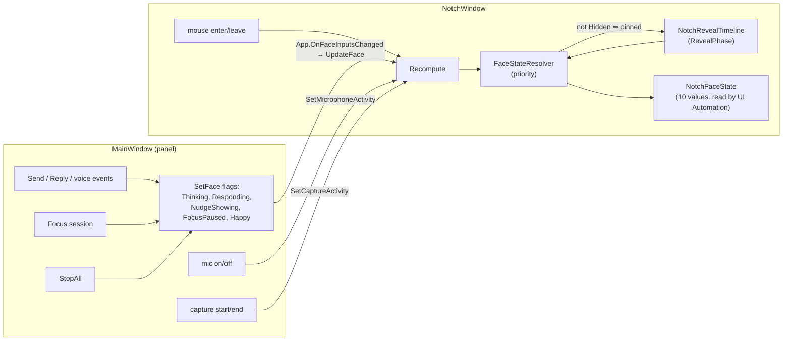
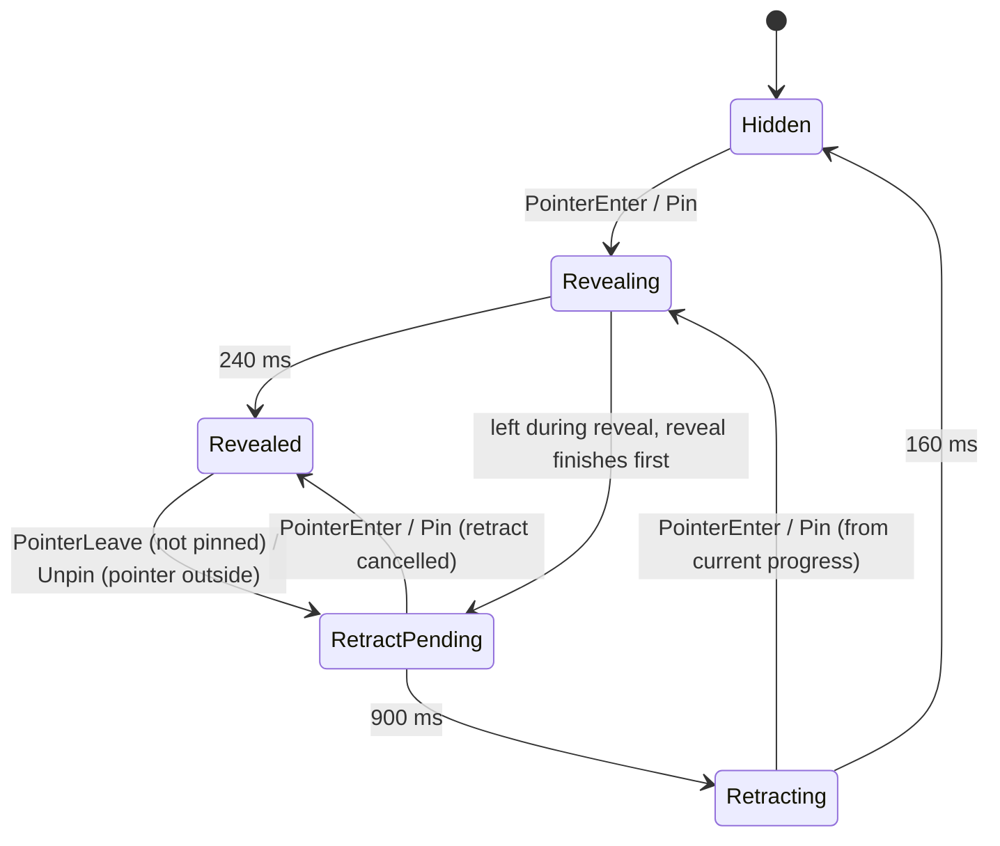
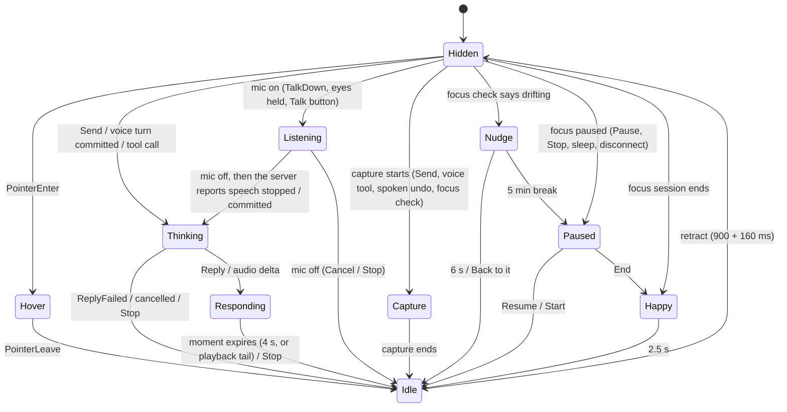
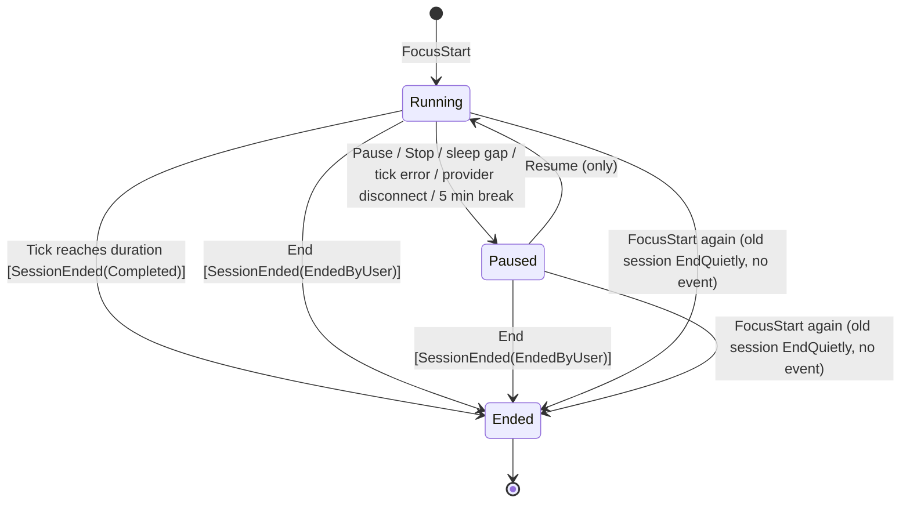
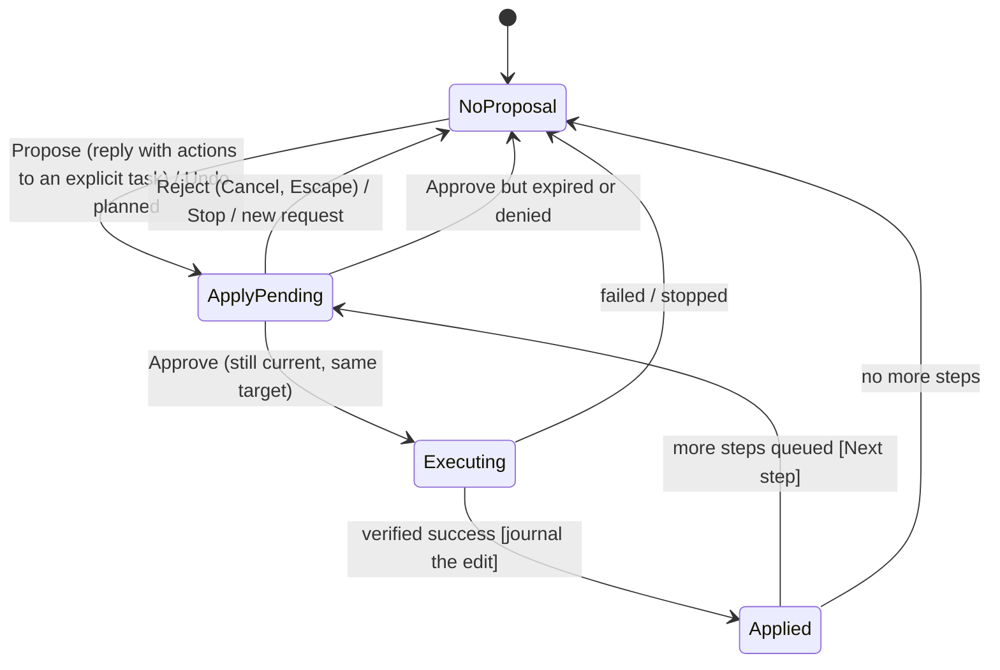

# Notch lifecycle: how Boo behaves today

Agent-trust plan, Phase 2, PR 2.1 (`docs/plans/agent-trust-plan.md` §3.2 A). This is a map of the states and events of
the notch and the features that drive it, **as the code on `lane/face` at `af089dd` behaves**, written by reading the
code. It changes no behaviour. Later Phase 2 PRs (the TLA+ model, the `NotchLifecycle` reducer, the property tests)
start from this map, so any change to it must be agreed **before** behaviour moves.

Line numbers were re-checked on `lane/face` at `2433397` (after PR #33, one injected `TimeProvider`): every citation
was moved with the diff from `342b93d` and each moved line was compared word for word with the line it cited before.
PR #33 shifted `src/Boo.App/MainWindow.xaml.cs` (-1 for lines 72-86, +5 from line 110 on), `src/Boo.App/App.xaml.cs` (+2 from
line 38, +3 from line 153) and `src/Boo.Core/FocusSession.cs` (+1 from line 20); no other cited line moved. Two cited
lines changed text without changing meaning: the `CaptureAsync` calls at `src/Boo.App/MainWindow.xaml.cs:2042` and
`:1611` now pass the injected clock to `ScreenCapture`.

How to read the labels:

- **code**: confirmed by reading the cited lines. Every transition cites `file:line` (paths from the repo root).
- **live**: also seen in the real-key live run [43339557570](https://github.com/vikas53953/bluey/actions/runs/43339557570)
  (PR #13 QA head `3168e40`, journeys j0–j6, artifact `live-ai-evidence`). Line numbers are from `af089dd`; the
  lifecycle code the run exercised did not change between the two heads (only docs and CI files did).
- **UNVERIFIED**: could not be confirmed from code alone, or depends on timing/threads no run has shown. Never guessed.

---

## 1. The big picture (one paragraph)

There is **no single state machine** today. The notch face is a **pure function of flags**, recomputed whenever a flag
changes:

1. The main window (`MainWindow`) owns app flags: `Thinking`, `Responding`, `NudgeShowing`, `FocusPaused`, `Happy`
   (`SetFace`, `src/Boo.App/MainWindow.xaml.cs:157-178`).
2. The notch window (`NotchWindow`) owns `hovered`, `captureActive` and `microphoneActive`
   (`src/Boo.App/NotchWindow.xaml.cs:348-359`, `:1367-1379`).
3. `FaceStateResolver.Resolve` picks one of 10 face states by fixed priority (`src/Boo.Core/NotchFace.cs:38-53`).
4. Any non-Hidden result **pins** the notch out; a reveal timeline (`NotchRevealTimeline`, `src/Boo.Core/NotchFace.cs:294-406`)
   slides it in and out (`src/Boo.App/NotchWindow.xaml.cs:499-522`).

Around that sit small, separate machines with their own state: hold-to-talk, focus sessions, request generations,
the approval card, the two undo journals and the pointer/ring sequencer. Section 3 has one diagram and table for each.

Wiring: `src/Boo.App/App.xaml.cs:74-87` (panel created at startup, notch created, `FaceInputsChanged`,
`EyesHeldChanged`, `NudgeActionChosen`), `src/Boo.App/App.xaml.cs:142-171` (capture/mic callbacks, `UpdateFace`).

## 2. The plan's states mapped to today's code

The plan (§3.2 A) names 11 abstract states. Today they are not one variable; this is where each one lives.

| Plan state | Today | Where |
| --- | --- | --- |
| `Hidden` | `NotchFaceState.Hidden` with `RevealPhase.Hidden` | `src/Boo.Core/NotchFace.cs:52`, `:353-355` |
| `Hover` (peek) | `NotchFaceState.Hover` = pointer is over the notch and no higher flag | `src/Boo.Core/NotchFace.cs:50`; `src/Boo.App/NotchWindow.xaml.cs:1367-1372` |
| `Awake` (idle, panel ready) | **No such notch state.** `NotchFaceState.Idle` only means "revealed, pointer not on it"; in practice it is the short tail on the way out (retract delay). Whether the panel is open does not change the notch face (one exception: if the selected display is gone, opening the panel runs Stop, F21). | `src/Boo.Core/NotchFace.cs:51`; `src/Boo.App/App.xaml.cs:105-140` (opening the panel calls `RefreshSelectedDisplay`, `src/Boo.App/MainWindow.xaml.cs:605`, which runs `StopAll` when the selected display is gone, `:617-619`, and otherwise re-places the notch and refreshes the capture indicator only when the display's bounds or scale changed, returning early at `:646-649`). Note: the journey harness comment "The open panel keeps the face awake" (`tools/Boo.VerifyLive/LiveJourneyTests.cs:79`) is not supported by the code; no `SetFace` call depends on the panel |
| `Chat` (thinking → responding) | `Thinking` flag, then `Responding` flag held as a timed "moment" | `src/Boo.App/MainWindow.xaml.cs:748`, `:958`, `:2263`, `:2286`, `:2306-2307` |
| `Listening` | `microphoneActive` in the notch (the app-level `FaceInputs.Listening` flag is never set by any caller) | `src/Boo.App/NotchWindow.xaml.cs:355-359`, `:505` |
| `Capture` | `captureActive` in the notch, from the capture tracker (the app-level `FaceInputs.CaptureActive` is never set) | `src/Boo.App/MainWindow.xaml.cs:707-716`; `src/Boo.App/NotchWindow.xaml.cs:348-353`, `:504` |
| `Interrupt` (Stop) | **No state.** `StopAll` is a function that resets flags in one call; the notch only flashes a "Stopped" screen-reader status for a hotkey Stop, or for any Stop while no panel exists | `src/Boo.App/MainWindow.xaml.cs:270-318`; `src/Boo.App/NotchWindow.xaml.cs:318-334`, `:1650-1656`; `src/Boo.App/App.xaml.cs:197-201` |
| `Focus` (running / paused / nudge / ended) | `FocusStatus` `Running`/`Paused`/`Ended` in Core; on the notch `Paused`, `Nudge` (6 s moment), `Happy` (2.5 s moment). A running session with no nudge shows nothing on the notch except its periodic `Capture`. | `src/Boo.Core/Contracts.cs:11`; `src/Boo.App/MainWindow.xaml.cs:1551-1555`; `src/Boo.App/MainWindow.Focus.cs:43` |
| `ApplyPending` | The approval card in the **panel** (`ActionPreview` visible, `_pendingPreview` set). No notch state. | `src/Boo.App/MainWindow.xaml.cs:1123-1138` |
| `Applied` | An undo journal holds the edit | `src/Boo.App/MainWindow.Edits.cs:243-245`, `:307`, `:504-533` |
| `Undone` | The field journal is cleared after a verified undo; the file journal records the undo as a new edit (see finding F6) | `src/Boo.Core/UndoJournal.cs:197-213`; `src/Boo.App/MainWindow.Edits.cs:504-533` |

## 3. The machines, one by one

### 3.1 Reveal timeline (`RevealPhase`, 5 values)

`src/Boo.Core/NotchFace.cs:285` (enum), `:294-406` (logic). Shipped timings: reveal 240 ms, retract delay 900 ms,
retract 160 ms (`docs/design/boo-notch-spec.json:255-259`). "Pinned" = the face would be non-Hidden even without the
pointer (`src/Boo.App/NotchWindow.xaml.cs:510-512`).

| # | From → To | Event | Cite | Label |
| --- | --- | --- | --- | --- |
| R1 | Hidden → Revealing | Pointer enters the notch strip | `src/Boo.App/NotchWindow.xaml.cs:1367-1371` → `src/Boo.Core/NotchFace.cs:311-315`, `:380-382`, `:392`, `:347` | code, live (j1 `revealed=True`; the harness reads the face state, not the reveal phase) |
| R2 | Revealing → Revealed | 240 ms pass | `src/Boo.Core/NotchFace.cs:347`, `:395-396` | code |
| R3 | Revealed → RetractPending | Pointer leaves and nothing pins | `src/Boo.App/NotchWindow.xaml.cs:1374-1378` → `src/Boo.Core/NotchFace.cs:317-324`, `:351` | code, live (j1 `retracted=True`; face state, the phase is inferred) |
| R4 | Revealing → RetractPending | Pointer left mid-reveal: the reveal finishes, then the 900 ms delay starts from whichever is later (leave or reveal end) | `src/Boo.Core/NotchFace.cs:349`, `:398-403` | code |
| R5 | RetractPending → Retracting | 900 ms pass | `src/Boo.Core/NotchFace.cs:350-352` | code |
| R6 | Retracting → Hidden | 160 ms pass | `src/Boo.Core/NotchFace.cs:352-353` | code, live (j1 `retracted=True`) |
| R7 | RetractPending → Revealed | Pointer re-enters (or a pin arrives): retract cancelled, reveal kept | `src/Boo.Core/NotchFace.cs:383-392` (comment `:389`) | code |
| R8 | Retracting → Revealing | Pointer re-enters (or pin): reveal restarts from the current progress | `src/Boo.Core/NotchFace.cs:387-388` | code |
| R9 | any → Revealing/Revealed | Pin: a face flag above Hidden appears (capture, mic, thinking, nudge, …) | `src/Boo.App/NotchWindow.xaml.cs:510-512` → `src/Boo.Core/NotchFace.cs:327-334` | code, live (j6 `Hidden>Capture`; face state only, the reveal phase is inferred) |
| R10 | Revealed → (stays) | Pointer leaves while pinned: no retract | `src/Boo.Core/NotchFace.cs:320` | code |
| R11 | Revealed → RetractPending | Unpin while the pointer is outside: the 900 ms delay starts at the unpin | `src/Boo.Core/NotchFace.cs:335-339` | code, live (j6 `Capture>Idle>Hidden`; face state only, the reveal phase is inferred) |

Notes (code): the internal mode never goes back to `Mode.Hidden`; after a retract it stays `Leaving` and `PhaseAt`
reports `Hidden` (`src/Boo.Core/NotchFace.cs:348-353`); a later `Show` from that point restarts the reveal from 0
(`:384-386`). Phase changes caused only by time are picked up by the render loop, which recomputes the face when the
phase and face disagree about Hidden (`src/Boo.App/NotchWindow.xaml.cs:639-659`); the loop keeps running while the
phase is not Hidden (`src/Boo.Core/RenderBudget.cs:12-13`, `src/Boo.App/NotchWindow.xaml.cs:669-674`).

### 3.2 Face state (`NotchFaceState`, 10 values)

`src/Boo.Core/NotchSpec.cs:15` (enum). Priority, highest first (`src/Boo.Core/NotchFace.cs:22-53`):
**Capture > Listening > (UserHidden ⇒ Hidden) > Responding > Thinking > Nudge > Happy > Paused > Hover > Idle > Hidden.**
The face is recomputed on every flag change (`src/Boo.App/NotchWindow.xaml.cs:499-522`) and published to UI Automation
(`src/Boo.App/NotchWindow.xaml.cs:524-529`, `:1269`). `UserHidden` exists in the resolver but **no caller sets it**
(searched `src/`, only `src/Boo.Core/NotchFace.cs:18`, `:44`).

**Capture lasts through the AI call, not only the screenshot.** On a typed question answered on the plain-text path, a voice `screen_help` tool, a spoken "undo" and a
focus check, the capture operation is disposed in a `finally` after the AI answers or the work ends (`src/Boo.App/MainWindow.xaml.cs:2034`,
`:827`, `:850`; `:2399`, `:2437-2439`; `src/Boo.App/MainWindow.Edits.cs:139`, `:157`, `:177`; `src/Boo.App/MainWindow.xaml.cs:1533`, `:1587`). Because Capture outranks Thinking, the Thinking face is not
seen during those calls; the notch shows Capture until the answer (or the cancel) arrives. If no frame is taken, the
operation ends at once (`src/Boo.App/MainWindow.xaml.cs:757-760`). When a typed question is handed to the voice session instead (speech on), the
`finally` runs as soon as the text is sent (`:802-806`, `:848-850`), so Capture ends before the reply and Thinking stays
visible while waiting (`:851`).

"→ Idle" above means "the flag clears"; the face then falls to the next flag by priority, or to Idle → Hidden through
the reveal timeline when nothing else is set. Every arrow is in the table:

| # | Event | Flag change | Cite | Label |
| --- | --- | --- | --- | --- |
| F1 | Pointer enters | `hovered = true` → `Hover` (if nothing higher) | `src/Boo.App/NotchWindow.xaml.cs:1367-1371`; `src/Boo.Core/NotchFace.cs:50` | code, live (j1 `state='Hover'`) |
| F2 | Pointer leaves | `hovered = false` → `Idle` while the timeline is not Hidden, then `Hidden` | `src/Boo.App/NotchWindow.xaml.cs:1374-1378`, `:515`, `:654-659`; `src/Boo.Core/NotchFace.cs:51-52` | code, live (j1 `retracted=True`) |
| F3 | Send (typed question) | `Thinking = true`, `Responding = false`. Every Send first drops any old voice session (`BeginRequest`). With speech on (the default, `src/Boo.Core/Contracts.cs:36`) and not muted, Send then opens a new voice session and hands the text to it; the voice rows F7-F10b take over. The plain-text path (F4) runs when speech is off or muted, or when that connect fails with `InvalidOperationException` / `HttpRequestException`; that includes the 15 s connect timeout and classified auth/quota/server failures, which are `ProviderException`, a kind of `InvalidOperationException`. Only a cancel, or a failure sending the text after connect, ends in F6 | `src/Boo.App/MainWindow.xaml.cs:733-748`, `:771-806` (filter `:784`), `:841`, `:1969-1979`; `src/Boo.Core/ProviderFailure.cs:32`; `src/Boo.Providers/RealtimeClient.cs:358-372`, `:384-390` | code, live for the speech-off branch only (j2) |
| F4 | Reply (typed, plain-text path) | `Thinking = false`, `Responding = true` held 4 s | `src/Boo.App/MainWindow.xaml.cs:955-958` | code, live (j2 reply `'Paris'`) |
| F5 | Responding moment expires | `Responding = false` by the moment timer | `src/Boo.App/MainWindow.xaml.cs:180-207`; `src/Boo.Core/FaceMomentSchedule.cs:43-50` | code |
| F6 | Reply failed / cancelled / stale (typed) | `Thinking = false` only if the request is still current **and the text was not handed to the voice session** (`!handedToRealtime`); a newer request or Stop owns the face otherwise | `src/Boo.App/MainWindow.xaml.cs:834-855` (condition `:851`) | code |
| F7 | Voice: speech started / stopped / committed | `Thinking = false` on started, `true` on stopped/committed | `src/Boo.App/MainWindow.xaml.cs:2257-2264` | code |
| F8 | Voice: audio delta | `Thinking = false`, `Responding = true`, 4 s moment refreshed on every delta | `src/Boo.App/MainWindow.xaml.cs:2283-2286` | code |
| F9 | Voice: `response.done` | `Thinking = tools in flight > 0`; `Responding` held for the remaining playback (`FaceMoments.AfterReplyDone`), only if Responding is already on (otherwise `SetFace` drops the hold) | `src/Boo.App/MainWindow.xaml.cs:2302-2307`, `:166-170`; `src/Boo.Core/FaceMoments.cs:22-30` | code |
| F10 | Voice: disconnect / error | `StopListening` clears `Thinking` and `Responding`; a running focus session is paused (`FocusPaused = true`) | `src/Boo.App/MainWindow.xaml.cs:2309-2320`, `:950-952` | code |
| F10b | Voice tool `go_to_sleep` | after the spoken reply finishes (or an 8 s fallback) the voice session ends through `StopListening`: Thinking and Responding cleared, mic off; focus untouched | `src/Boo.App/MainWindow.Voice.cs:64-66`, `:76-81`, `:84-99`, `:104`, `:124-137` | code |
| F11 | Voice tool call (`screen_help`) | `Thinking = true`; its answer goes through `RenderReply` (`Thinking = false`, `Responding = true`, as F4); later reply events also clear it; every voice undo resets it in its `finally` if the request is still current (`src/Boo.App/MainWindow.Edits.cs:178`) After the answer (or a failure) the tool awaits `CompleteToolAsync` (a websocket send with no timeout of its own) before its `finally` ends the capture, so the Capture face can stay on until that returns, Stop, or a new request (`src/Boo.App/MainWindow.xaml.cs:2417`, `:2429`, `:2437-2442`) | `src/Boo.App/MainWindow.xaml.cs:2369-2371`, `:2410`; `src/Boo.App/MainWindow.Edits.cs:174-182` | code |
| F12 | Microphone on | notch `microphoneActive = true` → `Listening` | `src/Boo.App/MainWindow.Talk.cs:260-261`; `src/Boo.App/MainWindow.xaml.cs:889-890`; `src/Boo.App/NotchWindow.xaml.cs:355-359`, `:505`; `src/Boo.Core/NotchFace.cs:43` | code |
| F13 | Microphone off | `microphoneActive = false` | `src/Boo.App/MainWindow.Talk.cs:396-397`; `src/Boo.App/MainWindow.xaml.cs:302`, `:900`, `:931` | code |
| F14 | Capture starts | tracker gets an active display → `SetCaptureActivity(true)` → `Capture` | `src/Boo.App/MainWindow.xaml.cs:2034-2035` (typed / voice tool / spoken undo, which captures through the same `CaptureForRequestAsync` from `src/Boo.App/MainWindow.Edits.cs:139-177`), `src/Boo.App/MainWindow.xaml.cs:1603-1604` (focus check), `:707-716`; `src/Boo.App/NotchWindow.xaml.cs:348-353`, `:504`; `src/Boo.Core/NotchFace.cs:42` | code, live (j6 `Hidden>Capture` ×N) |
| F15 | Capture ends | operation disposed → indicator refresh | `src/Boo.App/MainWindow.xaml.cs:718-722`, `:850`, `:1587`; `src/Boo.Core/CaptureActivityTracker.cs:57-72` | code, live (j6 `Capture>Idle`) |
| F16 | Focus check says drifting | `NudgeShowing = true` held 6 s, caption set | `src/Boo.App/MainWindow.xaml.cs:1546-1555` | code (j6 `nudges=0`, so not live) |
| F17 | Nudge "Back to it" / "5 min break" | `NudgeShowing = false`; break also pauses focus | `src/Boo.App/NotchWindow.xaml.cs:1027`, `:1033` → `src/Boo.App/App.xaml.cs:86` → `src/Boo.App/MainWindow.xaml.cs:1389-1397` | code |
| F18 | Focus session ends (completed or End) | `FocusPaused = false`, `Happy = true` held 2.5 s | `src/Boo.App/MainWindow.Focus.cs:22-46` | code, live (j6 `>Happy`, `sawHappy=True`) |
| F19 | Focus paused (Pause, Stop, sleep gap, tick error, provider disconnect) | `FocusPaused = true` | `src/Boo.App/MainWindow.xaml.cs:1380`, `:317`, `:1462`, `:1492`, `:2319` | code |
| F20 | Focus Start / Resume | `FocusPaused = false` (Start also `Happy = false`) | `src/Boo.App/MainWindow.xaml.cs:1358`, `:1419` | code |
| F21 | **Stop** (Ctrl+Alt+F12, Ctrl+Alt+S, tray Stop, panel Stop, right-click on the notch, lock/logoff, sleep, update restart, quit; and internally: selected display gone, annotation window cannot be hidden from capture, colour chooser opened while active, crash handlers) | replaces all app flags with `FocusPaused = (focus is paused)`: clears Thinking, Responding, Nudge, Happy and the caption; mic off; capture indicator refreshed | `src/Boo.App/MainWindow.xaml.cs:270-318`; sources: `src/Boo.App/NotchWindow.xaml.cs:1650-1656`, `:1381-1385`; `src/Boo.App/App.xaml.cs:191-202`, `:213`, `:228-232`, `:240-244`; `src/Boo.App/MainWindow.xaml.cs:1920`; update restart `src/Boo.App/MainWindow.Updates.cs:220`; quit `src/Boo.App/App.xaml.cs:426` → `src/Boo.App/MainWindow.xaml.cs:320-323`; internal `:617-619`, `:1034`, `:1891`; crash handlers `src/Boo.App/App.xaml.cs:313`, `:318`, `:351`, `:358` | code |
| F22 | Hotkey Ctrl+Alt+B | opens the panel; **no notch flag changes** (except Stop when the selected display is gone, see the `Awake` row in section 2) | `src/Boo.App/NotchWindow.xaml.cs:1643-1649` → `src/Boo.App/App.xaml.cs:77`, `:105-140` | code; live for the panel (j0); the notch face is not logged, but the notch capture `j0-after-hotkey.boo-0.png` is all black, consistent with a collapsed notch but thin evidence |
| F23 | Click on the eyes (< 200 ms) | opens the panel (same as F22) | `src/Boo.App/NotchWindow.xaml.cs:1322-1335`, `:1307-1311` | code |
| F24 | Press and hold the eyes (≥ 200 ms) | `EyesHeldChanged(true)` → hold-to-talk (§3.3) | `src/Boo.App/NotchWindow.xaml.cs:1313-1320`, `:1351-1365`; `src/Boo.Core/NotchFaceGeometry.cs:58`; `src/Boo.App/App.xaml.cs:85` | code |

### 3.3 Hold-to-talk (`HoldToTalkController`)

Pure Core machine, time from an injected `TimeProvider` (`src/Boo.Core/HoldToTalk.cs:43-72`). Two hold sources (the
Ctrl+Alt+Space chord from a low-level keyboard hook, and holding the eyes); listening ends when the **last** holder
lets go. The panel's **Talk** button is a separate toggle path (`src/Boo.App/MainWindow.xaml.cs:858-913`) that does
not use this controller.

```mermaid
stateDiagram-v2
  [*] --> Idle
  Idle --> Listening: TalkDown (chord) / EyesPressed  [StartListening, or Interrupt+Start if a reply is playing]
  Listening --> Listening: one holder released, other still held
  Listening --> Idle: last release ≥ 200 ms [StopAndSend]
  Listening --> Idle: last release < 200 ms [Cancel + "Hold to talk"]
  Listening --> Idle: Stop / lock / sleep [Cancel; later releases ignored]
  Listening --> Idle: held > 120 s [StopAndSend]
  Listening --> Idle: voice disconnect / error / go_to_sleep [AbortHoldToTalk: no command; the shell tears the session down]
```

| # | From → To | Event | Command | Cite | Label |
| --- | --- | --- | --- | --- | --- |
| H1 | Idle → Listening | fresh Ctrl+Alt+Space | `StartListening` (or `Interrupt`, `StartListening` while a reply plays) | `src/Boo.Core/HoldToTalk.cs:81-98`, `:176-187` | code |
| H2 | Idle → Listening | eyes held ≥ 200 ms | same | `src/Boo.Core/HoldToTalk.cs:124-133`; glue `src/Boo.App/MainWindow.Talk.cs:35-44` | code |
| H3 | Listening → Listening | one source released, the other still held | none | `src/Boo.Core/HoldToTalk.cs:120`, `:144` | code |
| H4 | Listening → Idle | last release after ≥ 200 ms | `StopAndSend` | `src/Boo.Core/HoldToTalk.cs:105-121`, `:136-145`, `:189-200` | code |
| H5 | Listening → Idle | last release before 200 ms | `Cancel`, hint "Hold to talk" | `src/Boo.Core/HoldToTalk.cs:197-198` | code |
| H6 | Listening → Idle | Stop, session lock, suspend | `Cancel`; both holds cleared so later releases do nothing | `src/Boo.Core/HoldToTalk.cs:153-160`, `:202-213`; glue `src/Boo.App/MainWindow.Talk.cs:86`, `:113-127`; `src/Boo.App/MainWindow.xaml.cs:272` | code |
| H7 | Listening → (as H3/H4/H5) | the eyes lose mouse capture | the notch raises `EyesHeldChanged(false)`, i.e. an eye release. `HoldToTalkController.FocusLost` (`src/Boo.Core/HoldToTalk.cs:151`) is reachable only through `MainWindow.TalkFocusLost` (`src/Boo.App/MainWindow.Talk.cs:47`), which **nothing calls**: focus loss itself is not wired | `src/Boo.App/NotchWindow.xaml.cs:1342-1349` | code |
| H8 | Listening → Idle | held longer than 120 s (250 ms ticker) | `StopAndSend` | `src/Boo.Core/HoldToTalk.cs:163-174`; `src/Boo.App/MainWindow.Talk.cs:57-58`, `:196-208` | code |
| H9 | Listening → Idle | voice disconnect or error, `go_to_sleep`, or a mic/realtime failure | none: `AbortHoldToTalk` calls `Stop` and drops its `Cancel`, because the caller already stops the mic and the session (`StopListening`) | `src/Boo.App/MainWindow.Talk.cs:405-421`; `src/Boo.App/MainWindow.xaml.cs:2311-2312`; `src/Boo.App/MainWindow.Voice.cs:136-137` | code |

What the shell does with each command (`src/Boo.App/MainWindow.Talk.cs:170-189`): `StartListening` starts a new
request generation unless it can reuse the open voice session, opens the microphone **before** connecting and only
then lights the mic indicator (`:225-276`); `StopAndSend` turns the mic off first, then commits the turn if at least
4,800 bytes were captured (`:299-330`); `Cancel` turns the mic off and discards the audio (`:352-368`). A newer hold
that supersedes one still connecting only discards the old turn's audio (`:278-284`). A mic or realtime failure ends
the hold and the voice session (`:405-421`).

### 3.4 Focus session (`FocusSessionController` / `FocusSession`)

`FocusStatus { Running, Paused, Ended }` (`src/Boo.Core/Contracts.cs:11`).

| # | From → To | Event | Cite | Label |
| --- | --- | --- | --- | --- |
| Fo1 | none → Running | Start: task not blank and minutes > 0 are checked; the duration is then clamped to 1–240 min. Also reachable by the voice tool `focus_start` | `src/Boo.App/MainWindow.xaml.cs:1320-1359` (checks `:1322`, `:1327`; clamp `:1347`); `src/Boo.Core/FocusSession.cs:23-26`; voice `src/Boo.App/MainWindow.Voice.cs:45-54` | code, live (j6 `minutes=25`) |
| Fo2 | Running/Paused → Ended (quiet) | Start while a session is live: old one ends with **no** end event | `src/Boo.App/MainWindow.xaml.cs:1338-1346`; `src/Boo.Core/FocusSessionController.cs:152-159` | code |
| Fo3 | Running → Paused | Pause button; Stop; clock gap (sleep); tick exception; provider disconnect; nudge "5 min break" | `src/Boo.App/MainWindow.xaml.cs:1366-1381`, `:308-315`, `:1453-1463`, `:1486-1492`, `:2313-2319`, `:1392-1394`; voice `focus_pause` `src/Boo.App/MainWindow.Voice.cs:55-57` (refused while a session is live in any voice session that is not push-to-talk, i.e. Talk button or a typed question handed to voice, `src/Boo.Core/VoiceCommands.cs:193-194`, `src/Boo.App/MainWindow.Voice.cs:37`); `src/Boo.Core/FocusSession.cs:63-71`; `src/Boo.Core/FocusSessionController.cs:128-132` | code |
| Fo4 | Paused → Running | Resume only, by button or voice `focus_resume` (unlock and reconnect never resume) | `src/Boo.App/MainWindow.xaml.cs:1399-1419`; `src/Boo.App/MainWindow.Voice.cs:58-60`; `src/Boo.Core/FocusSession.cs:73-77` | code |
| Fo5 | Running → Ended | Tick reaches the planned duration (4× clock in Developer Mode) | `src/Boo.App/MainWindow.xaml.cs:1465`; `src/Boo.Core/FocusSessionController.cs:80-92`; `src/Boo.Core/FocusSession.cs:50-61` | code, live (j6 `Completed`) |
| Fo6 | Running/Paused → Ended | End button or voice `focus_end` (voice refused while a session is live in any non-push-to-talk voice session, `src/Boo.Core/VoiceCommands.cs:193-194`, `src/Boo.App/MainWindow.Voice.cs:37`) | `src/Boo.App/MainWindow.xaml.cs:1427-1436`; `src/Boo.App/MainWindow.Voice.cs:61-63`; `src/Boo.Core/FocusSessionController.cs:137-144` | code |
| Fo7 | (Ended) | `SessionEnded` raised at most once → Happy face, chirp, save | `src/Boo.Core/FocusSessionController.cs:161-168`; `src/Boo.App/MainWindow.Focus.cs:22-46` | code, live (j6 `sawHappy=True`) |
| Fo8 | Running → Running | Check due (every 30 s, 10 s in Developer Mode, paused time not counted) → capture → classify → maybe Nudge | `src/Boo.App/MainWindow.xaml.cs:1502-1563`; `src/Boo.Core/FocusSessionController.cs:74`, `:98-111` | code, live (j6: 35 `Hidden>Capture>Idle` cycles in `states=`) |

### 3.5 Request generations (`RequestCoordinator`)

Every user request (typed Send, Talk, a new hold) gets a new **generation**; anything from an older generation is
dropped.

| # | Event | Effect | Cite | Label |
| --- | --- | --- | --- | --- |
| G1 | New request (`BeginRequest`) | stops listening, drops the old voice session, cancels the old token, new generation, clears annotations and the approval card | `src/Boo.App/MainWindow.xaml.cs:1967-1993`; `src/Boo.Core/RequestCoordinator.cs:11-22` | code |
| G2 | Stop | no generation is current until the next Begin | `src/Boo.App/MainWindow.xaml.cs:273-279`; `src/Boo.Core/RequestCoordinator.cs:24-36` | code |
| G3 | Voice session ends (`StopListening` with a voice session) | same as Stop for the coordinator, plus generation bump, approval card cleared | `src/Boo.App/MainWindow.xaml.cs:932-941` | code |
| G4 | Any async result arrives | applied only if `IsCurrent(generation)` | `src/Boo.App/MainWindow.xaml.cs:1995-2002`; `src/Boo.Core/RequestCoordinator.cs:38-44`, `:79-81` | code |
| G5 | A desktop action commits | the side effect runs inside `TryCommit` under the coordinator's lock, so Stop and a commit cannot interleave | `src/Boo.Windows/DesktopTools.cs:130`, `:165`, `:223`, `:287`, `:332`, `:384`, `:467`; `src/Boo.Core/RequestCoordinator.cs:46-62`; wiring `src/Boo.App/MainWindow.xaml.cs:2214` | code |

### 3.6 Approval card (Propose → Approve / Reject)

| # | From → To | Event | Cite | Label |
| --- | --- | --- | --- | --- |
| A1 | NoProposal → ApplyPending | Reply carries actions **and** the user's text was an explicit task; actions in other replies are dropped with a message | `src/Boo.App/MainWindow.xaml.cs:971-1000`, `:1123-1138` | code, live (j5 `preview='Write file'`) |
| A2 | ApplyPending → NoProposal | Cancel button, Escape | `src/Boo.App/MainWindow.xaml.cs:1293-1318`, `:1942-1949` | code |
| A3 | ApplyPending → NoProposal | Stop or any new request | `src/Boo.App/MainWindow.xaml.cs:306`, `:1987` | code |
| A4 | ApplyPending → NoProposal | Approve, but the request is no longer current, the policy denies, or the target window changed | `src/Boo.App/MainWindow.xaml.cs:1182-1227` | code |
| A5 | ApplyPending → Executing | Approve: an approval ticket is made for **this exact request** (digest of name, target, arguments, generation) and re-checked before every effect | `src/Boo.App/MainWindow.xaml.cs:1178`, `:1202`, `:1230`; `src/Boo.Core/ActionPolicy.cs:42-45`, `:62-82`; `src/Boo.Windows/DesktopTools.cs:968-971` | code, live (j5 `written='BOO-LIVE-VERIFY-OK'`) |
| A6 | Executing → Applied | verified success → journal the edit (file: `FileUndoJournal`; field: `UndoJournal`) | `src/Boo.App/MainWindow.xaml.cs:1231-1236`; `src/Boo.App/MainWindow.Edits.cs:243-245`, `:307`, `:504-533` | code, live (j5 `written=...` then the undo card) |
| A7 | Applied → ApplyPending | more steps queued | `src/Boo.App/MainWindow.xaml.cs:1251-1255` | code |
| A8 | Applied or Executing → NoProposal | no more steps, or failed or stopped (`finally`) | `src/Boo.App/MainWindow.xaml.cs:1257-1290` | code |

### 3.7 Undo (`UndoJournal` for fields, `FileUndoJournal` for files)

| # | Event | Effect | Cite | Label |
| --- | --- | --- | --- | --- |
| U1 | The user types or says "undo" | the request is classified as Undo; the **file** journal wins if it holds something, else the field journal. The two journals clear each other: a verified field edit clears the file journal (`src/Boo.App/MainWindow.Edits.cs:244`) and a recorded file edit clears the field journal (`:533`), so "undo" always targets the newest kind of edit | `src/Boo.App/MainWindow.xaml.cs:765-769`, `:2272-2280`; `src/Boo.App/MainWindow.Edits.cs:71-85` | code, live (j5 typed "undo" → `Undo: Delete file`) |
| U2 | Nothing recorded | message, no card (the app checks `HasPendingUndo` first, so the journals' own "nothing" plans are not reached from here) | `src/Boo.App/MainWindow.Edits.cs:74`, `:81-84` | code |
| U3 | File undo planned | the reverse step (write the old text, or delete a file Boo created) is shown as an `Undo:` card; blocked if the file changed since | `src/Boo.App/MainWindow.Edits.cs:455-478`; `src/Boo.Core/FileUndoJournal.cs:67-106` | code, live (j5 `undoPreview='Undo: Delete file'`) |
| U4 | Field undo planned | plan refuses on a newer change, an ambiguous Undo control, or an empty "before" value | `src/Boo.App/MainWindow.Edits.cs:93-123`; `src/Boo.Core/UndoJournal.cs:87-195` | code (demo-ci, mock: `02-undo-*`) |
| U5 | Undo approved (field) | after read-back the journal is cleared, so a second undo has nothing to do | `src/Boo.App/MainWindow.Edits.cs:227-233`, `:327-357`; `src/Boo.Core/UndoJournal.cs:197-213` | code |
| U6 | Undo approved (file) | the undo is itself a file write/delete, so it is **journaled as a new edit**; a second "undo" would plan to reverse the undo | `src/Boo.App/MainWindow.xaml.cs:1229-1236`; `src/Boo.App/MainWindow.Edits.cs:485-533` | code; behaviour of a second undo UNVERIFIED (no run does it) |

### 3.8 Pointer and ring (`PointerAnnotationSequencer`, `PointerPhase`, 6 values)

`src/Boo.Core/PointerGuidance.cs:217-219` (enums), `:245-363` (logic), glue in `src/Boo.App/AnnotationWindow.xaml.cs`.

```mermaid
stateDiagram-v2
  [*] --> Idle
  Idle --> Fly: Begin (flight > 0 ms)
  Idle --> Land: Begin (no flight)
  Fly --> Land
  Land --> DrawRing: 120 ms
  DrawRing --> Hold: stroke drawn
  Hold --> Idle: 10 s (explain ring) / 8 s (nudge ring); the last frame says Clear, reason Completed
  Fly --> Idle: Clear(reason)
  Land --> Idle: Clear(reason)
  DrawRing --> Idle: Clear(reason)
  Hold --> Idle: Clear(reason)
```

| # | Event | Cite | Label |
| --- | --- | --- | --- |
| P1 | Begin with an older or equal generation is refused | `src/Boo.Core/PointerGuidance.cs:274-277` | code |
| P2 | Begin while one is showing clears it first (`TargetChanged`) | `src/Boo.Core/PointerGuidance.cs:279-282` | code |
| P3 | Tick walks Fly → Land → DrawRing → Hold → Idle (`Completed`); `Clear` is only the phase of the returned last frame, `Phase` itself goes straight to Idle (`:333-352`); hold 10 s for the explain ring, 8 s default for the nudge ring | `src/Boo.Core/PointerGuidance.cs:292-335`; `src/Boo.App/AnnotationWindow.xaml.cs:66`, `:100` | code; live shows only the ring and pointer drawn on the target (j3), not the phase walk or hold time |
| P4 | Clear with any reason → Idle; the window closes with `Stop`; scroll, resize, foreground and display changes clear it | `src/Boo.Core/PointerGuidance.cs:338-354`; `src/Boo.App/AnnotationWindow.xaml.cs:87`, `:223`, `:281-298`; Stop/new request close the windows `src/Boo.App/MainWindow.xaml.cs:2595-2601`, `:305`, `:1986` | code |

## 4. The plan's invariants against today's code

| Id | Plain words | Today | Where |
| --- | --- | --- | --- |
| `INV-PRIV-1` | Mic or capture on ⇒ notch visible | **Indicator on ⇒ notch visible: enforced in the notch window, not by `PresenceController`. Microphone recording ⇒ indicator on: NOT always (finding F10).** Capture and Listening beat every other flag, including `UserHidden`, and pin the timeline out. The reveal takes 240 ms (Revealing) unless reduced motion. `PresenceController` (the class the plan names) is **not used by the app** (only by Core and tests). | `src/Boo.Core/NotchFace.cs:41-43`; `src/Boo.App/NotchWindow.xaml.cs:504-512`, reduced motion / wake-up shown at once `:683`, `:692-695`; `src/Boo.Core/NotchFace.cs:327-334`; unused: `src/Boo.Core/PresenceController.cs:3` |
| `INV-PRIV-2` | No capture starts while Hidden without approval | **Not enforced as written.** Captures need no approval: they start on a typed Send, a voice tool call, a spoken "undo", or a focus check. For a typed Send and a voice tool call, `Thinking` is set first (`src/Boo.App/MainWindow.xaml.cs:748`, `:2371`) and already pins the notch out before the capture starts; a spoken undo sets no flag itself, but the voice turn has usually set Thinking (F7) or Listening already (`src/Boo.App/MainWindow.Edits.cs:139-157`); for a focus check, starting the capture is what reveals the notch (`src/Boo.App/MainWindow.xaml.cs:1603`). In every path the indicator is set, then the code yields once to the UI before grabbing the frame. Whether the notch is already on screen at the moment of the grab is UNVERIFIED (timing). | `src/Boo.App/MainWindow.xaml.cs:2034-2042`, `:1603-1611` |
| `INV-APPLY-1` | Apply only after Approve of the same proposal | **Enforced.** The ticket is a digest of the exact request (name, target, arguments, generation) and is re-checked before each effect. There is no separate proposal id; the digest plays that role. | `src/Boo.Core/ActionPolicy.cs:62-82`; `src/Boo.App/MainWindow.xaml.cs:1178`, `:1202`, `:1230`; `src/Boo.Windows/DesktopTools.cs:968-971` |
| `INV-APPLY-2` | Undo only what was applied, only once; restores the before-state | **Fields: enforced** (plan needs a recorded edit, refuses newer changes, clears on verified undo). **Files: "only once" is not enforced**: the approved undo is journaled as a new edit, so a second undo reverses the undo (finding F6). | `src/Boo.Core/UndoJournal.cs:87-213`; `src/Boo.Core/FileUndoJournal.cs:31-59`; `src/Boo.App/MainWindow.Edits.cs:504-533` |
| `INV-APPLY-3` | A new request never applies an older proposal | **Enforced** three ways: a new request clears the card; policy denies a request whose generation differs from the authority; commits run inside `TryCommit` for the current generation. | `src/Boo.App/MainWindow.xaml.cs:1987`; `src/Boo.Core/ActionPolicy.cs:42-45`; `src/Boo.Core/RequestCoordinator.cs:46-62` |
| `INV-FOCUS-1` | Exactly one end event per session | **Partly: at most one is enforced.** `_endRaised` stops a second event. But a session replaced by a new Start ends with `EndQuietly` and emits **none**, and a session still open when Boo quits is only paused by `StopAll`, never ended (finding F9). | `src/Boo.Core/FocusSessionController.cs:152-168`; `src/Boo.App/MainWindow.xaml.cs:1343-1344`, `:320-323` |
| `INV-TALK-1` | After TalkUp or Stop, mic off | **Partly. For the push-to-talk microphone: enforced in the glue. For any microphone: NOT always** — a Talk-button microphone opened while the hold was down survives the release (finding F10). Also UNVERIFIED: the key hook runs on its own thread and posts the start to the UI thread (`src/Boo.App/MainWindow.Talk.cs:89-154`), so a Stop that lands between the key going down and the posted start may leave the microphone on (indicator visible) with no hold to release it. `StopAndSend` and `Cancel` both stop the mic before anything else; Stop cancels the hold, stops audio and clears the indicator. The mic is opened before the first `await` in `StartPushToTalk`, so a release queued behind it still finds it open and closes it (code reading; ordering on the UI thread). | `src/Boo.App/MainWindow.Talk.cs:253-261`, `:299-303`, `:352-356`; `src/Boo.App/MainWindow.xaml.cs:272`, `:285`, `:302` |
| `INV-STOP-1` | Stop from anywhere ⇒ quiet (Awake or Hidden), mic and capture off | **Partly.** Mic off: yes. Chat flags cleared: yes. But (a) **a running focus session is paused by Stop (and an already-paused one stays paused), and `Paused` pins the notch out**, so the notch stays visible showing Paused, not quiet; (b) capture: Stop cancels the work, but the capture indicator clears only when each in-flight operation is disposed, which happens after the AI call it wraps is cancelled (section 3.2), so `Capture` can outlast Stop briefly (UNVERIFIED how long). | `src/Boo.App/MainWindow.xaml.cs:270-318`, `:308-317`, `:718-722`, `:850`, `:1587`; `src/Boo.Core/NotchFace.cs:49` |
| `LIVE-1` | Chat always ends ("never stuck on Responding") | **Responding: enforced** by the moment timer (4 s, or the playback tail capped by `FaceMoments`). **Thinking: no local timeout.** Typed requests on the plain-text path end through the 45 s HTTP timeout and `finally`. But with speech on (the default) and a voice session connected, a typed question is handed to the voice session and `finally` leaves Thinking set (`src/Boo.App/MainWindow.xaml.cs:851`). A voice turn's Thinking (and such a hand-off) ends only on events, never on a timer: speech started again (`:2263`), an audio delta or `response.done`, error or disconnect, `go_to_sleep`, the end of a voice undo (`src/Boo.App/MainWindow.Edits.cs:181`), Talk toggled off or a mic failure (both through `StopListening`, `src/Boo.App/MainWindow.xaml.cs:950-952`), Stop, or a new request or hold. The voice client's 15 s connect timeout and 10 s keep-alive catch a dead connection, not a connected provider that stays silent; then Thinking stays (UNVERIFIED: no run has a silent provider). | `src/Boo.App/MainWindow.xaml.cs:180-207`, `:848-854`, `:2263`, `:771-806`, `:851`, `:2302-2312`, `:2128`; `src/Boo.Core/FaceMoments.cs:22-30`; `src/Boo.Providers/RealtimeClient.cs:292-294`, `:339-346` |
| `LIVE-2` | Hover with no more input returns to Hidden | **Only after the pointer leaves.** Hover means "pointer is on the notch", so it lasts as long as the pointer stays. After PointerLeave: Idle for 900 ms, retract 160 ms, Hidden, driven by the render loop. | `src/Boo.App/NotchWindow.xaml.cs:1374-1378`, `:654-659`; `src/Boo.Core/NotchFace.cs:317-353`; live (j1 `retracted=True`; its `retractMs=713` is shorter than 900 + 160 ms; likely explanation (inferred, not measured): the harness starts its clock only after the animated mouse move away returns, i.e. after the pointer already left, `tools/Boo.VerifyLive/LiveJourneyTests.cs:99-102`) |

## 5. Findings to settle before the model (no code changed here)

These are facts from reading the code that a TLA+ model or reducer must either copy or change on purpose. Each needs a
decision in its own PR, not here.

1. **F1 `PresenceController` is unused by the app.** The privacy rule lives in `FaceStateResolver` + the reveal timeline
   instead (`src/Boo.App/NotchWindow.xaml.cs:504-512`). The model should mirror the code path that runs.
2. **F2 `UserHidden`, `FaceInputs.Listening` and `FaceInputs.CaptureActive` are never set by the app.** Listening and
   Capture reach the face only through the notch's own mic/capture flags (`src/Boo.App/NotchWindow.xaml.cs:504-505`).
3. **F3 There is no "Awake" notch state.** The panel being open does not change the notch; `Idle` is only the retract
   tail. The plan's statechart should either drop `Awake` or say it is a panel state.
4. **F4 Stop is not a state and does not always end quiet**: with a running or paused focus session, Stop leaves the notch pinned
   on `Paused` (`INV-STOP-1` above). Either the invariant allows `Paused`, or Stop's behaviour changes.
5. **F5 Captures need no approval**; for focus checks the notch is revealed by the capture starting, for a typed or voice request by the Thinking face set just before it, and for a spoken undo by whatever the voice turn already showed (`INV-PRIV-2` above). The invariant as
   worded does not match the product; it needs rewording (for example "capture never runs without the Capture face
   being set first") or a behaviour change.
6. **F6 File undo toggles.** An approved file undo is journaled as a new edit, so "undo" twice re-applies the original
   edit. Field undo does not do this. The plan's property "double undo is a no-op" would fail for files today.
7. **F7 Thinking has no local timeout for voice turns, nor for typed text handed to the voice session** (speech on, the default; `LIVE-1` above).
8. **F8 Two talk paths.** The panel Talk button opens the mic without `HoldToTalkController`; a model of "Listening"
   must include both (`src/Boo.App/MainWindow.xaml.cs:858-913`). The voice session can also end itself (`go_to_sleep`, F10b) and drive focus (`focus_start/pause/resume/end`, `src/Boo.App/MainWindow.Voice.cs:43-66`); the model's event list needs these too.
9. **F9 A focus session can end with no end event**: a session replaced by a new Start ends quietly, and one still open at quit is only paused (`INV-FOCUS-1` above). The model must either allow zero end events for these or the behaviour changes.
10. **F10 The microphone can keep recording while the mic indicator is off** (found while writing the PR 2.2 model;
    code reading, UNVERIFIED by any run). Hold Ctrl+Alt+Space, click Talk twice (or Send, then Talk), then release the
    chord. The second Talk click opens a new microphone (`src/Boo.App/MainWindow.xaml.cs:866-890`; `BeginRequest`
    disposes the push-to-talk one, `:1970`), but the hold-to-talk controller was never told, so the release still
    sends `StopAndSend`. `StopPushToTalkMic` then turns the indicator off for every microphone but stops only the
    push-to-talk one (`src/Boo.App/MainWindow.Talk.cs:383-398`). Result: the Talk-button microphone keeps recording and
    streaming to the provider while the notch shows nothing. Details (confirmed by the PR #29 reviewer, still code reading): the release must come after the second click's
    connect finishes (before that, `src/Boo.App/MainWindow.xaml.cs:889-890` turns the indicator back on); the 120 s hold timeout triggers the same bug
    with no release; the Talk button keeps saying "Stop talk"; and once server-side speech detection fires, the notch
    reappears as Thinking or Responding, never as Listening. This breaks the privacy promise behind `INV-PRIV-1` (and
    `INV-TALK-1` as written). The model
    records it as the gaps `INV_PRIV_1_DEVICE` and `INV_TALK_1_DEVICE` (`specs/NotchLifecycle_plan_gaps.cfg`).

## 6. Cross-check against a live run

Real-key live run [43339557570](https://github.com/vikas53953/bluey/actions/runs/43339557570) (PR #13 QA head
`3168e40`, artifact `live-ai-evidence`, `journeys/`). The notch face state is read through UI Automation; the notch screenshots are black on black, so the cross-check rests mainly on those logs, with the panel screenshots (j2, j5) and the ring (j3) checked by eye.

| Journey | What it shows | Transitions it confirms |
| --- | --- | --- |
| j0 `j0-hotkey.txt`, `j0-after-hotkey.*.png` | Ctrl+Alt+B opens the panel; the notch capture shows it still collapsed | F22 |
| j1 `j1-hover.txt`, `j1-hover-revealed.boo-0.png` | `revealed=True state='Hover'`, then `retracted=True` | R1, R3, R6, F1, F2, LIVE-2 |
| j2 `j2-chat.txt`, `j2-chat-answer.*.png` | typed question, real reply `'Paris'` | F3, F4 (reply arrives; the Thinking/Responding faces themselves are not logged) |
| j3 `j3-explain-ring.*.png` | pointer and ring drawn on the target button (the notch state is not logged) | P3 |
| j5 `j5-apply-undo.txt`, `j5-*.png` | `Write file` card → written → `Undo: Delete file` card → file gone | A1, A5, A6, U1, U3 (a second undo is not run, so U6 stays UNVERIFIED) |
| j6 `j6-focus.txt`, `j6-focus-*.png` | `states=Hidden>Capture>Idle>Hidden>…>Happy` (35 capture cycles), `Completed`, `sawHappy=True` | Fo1, Fo5, Fo7, Fo8, F14, F15, F18, R9, R11 |

Not covered by any run: Listening (voice is UNVERIFIED by choice, `docs/DECISIONS.md` 12 Nov), Nudge (j6 `nudges=0`),
Paused, Stop, a second undo, a silent provider, and the typed-question hand-off to voice (the live fixture saves `SpeechEnabled: false`, `tools/Boo.LiveSmoke/LiveAppFixture.cs:123`, so j2 used the plain-text path). Video of runs arrives with PR 2.8.
