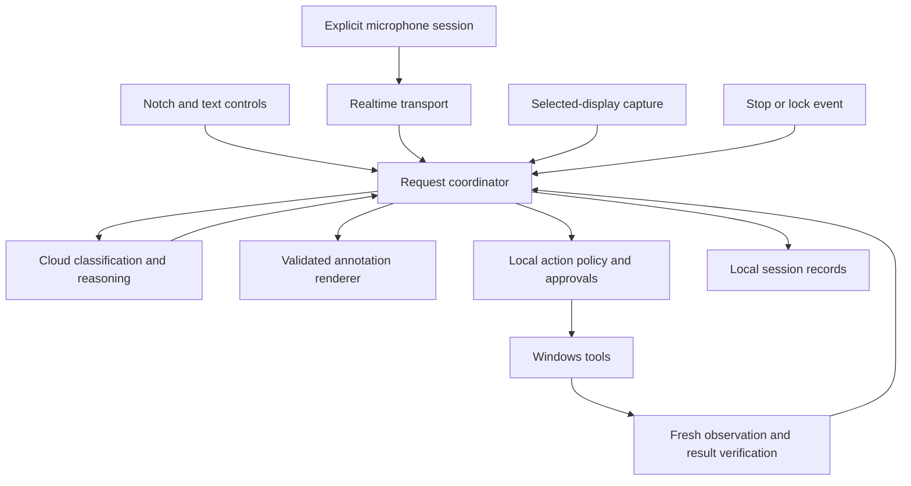
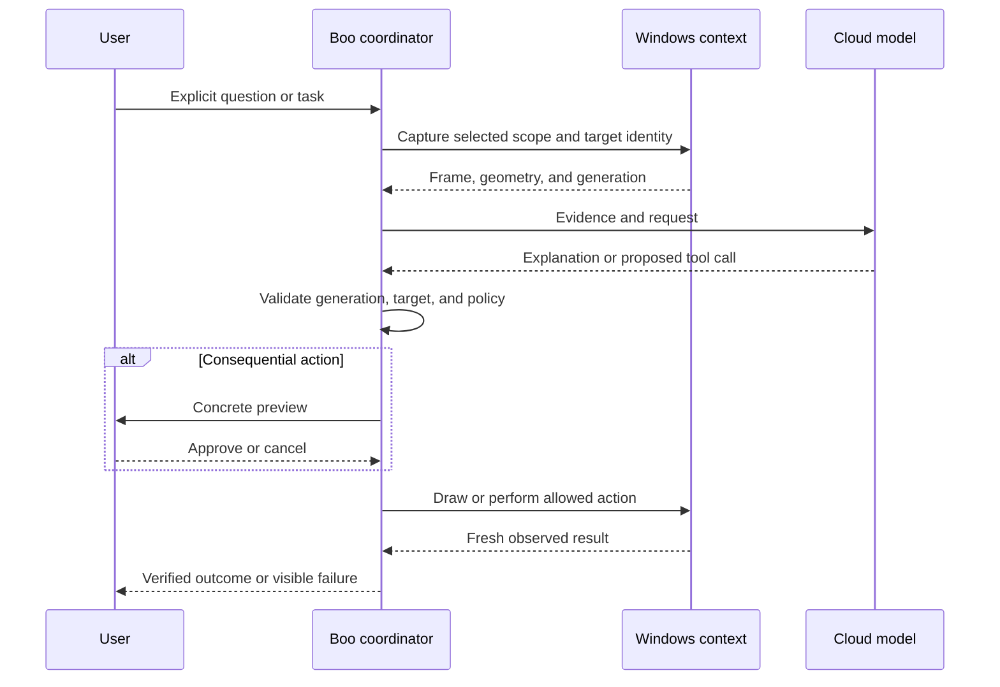
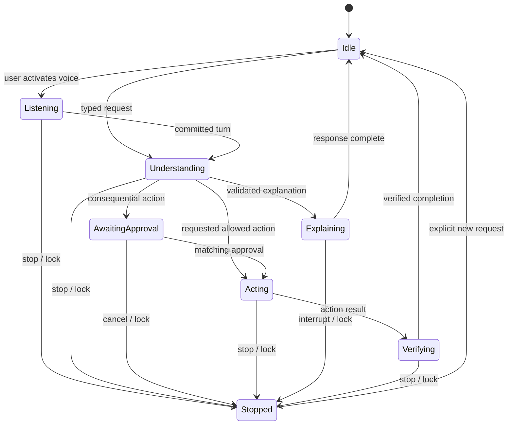

# Boo Windows Companion - Plan

## Goal Capsule

**Objective:** The user can understand what is on their Windows screen, ask for help by voice, delegate a task, and stay focused with a companion they enjoy keeping on screen.

**Means:** A native Windows companion with a top-center notch, transparent annotation windows, cloud voice and reasoning, and locally enforced action controls (KTD1–KTD6).

**Authority:** The user's latest decisions govern scope. Product requirements govern behavior; technical decisions govern implementation within those requirements. The visual prototype presents alternatives and does not approve itself.

**Current delivery:** The user reviewed the visual MVP and explicitly authorized autonomous implementation through Compound Engineering LFG, including parallel agents, tests before implementation, and independent QA. They selected the pocket notch, just-eyes avatar, and warm rounded typography, and directed the remaining visual treatment to follow HeyClicky. No further visual approval is required before work (R15–R17). The rejected generic lavender treatment is not the production design.

**Execution profile:** One local Windows application, delivered in the dependency order below. Initialize a local feature-branch checkout; each feature builder uses its own Git worktree, as required by the user's supplied pipeline. No remote push, public release, or PR is required. The root owns the canonical plan, integration, and final evidence. Independent test authors, builders, and QA use the user-requested GPT-6.1-Sol at extra-high effort where the route is available. Workers do not spawn descendants; the root dispatches parallel workers with disjoint ownership and integrates their branches after verification.

**Stop conditions:** A dependency failure blocks the affected lane, not unrelated work. Fail closed when capture scope cannot be made clear, annotations cannot be mapped reliably, or actions could proceed after cancellation. Live provider acceptance cannot pass without real credentials and model access. Report limitations instead of substituting simulated success. Continue repair and verification loops until the acceptance contract passes or a genuine external blocker prevents further progress.

---

## Product Contract

### Summary

Boo lives at the top center of the user's Windows display. The companion can explain the current screen with drawings, carry a voice or text conversation, search for information, and perform requested computer tasks. It also retains the focus companion from Riley Brown's Bluey: task sessions, timer, contextual distraction checks, nudges, and session history.

The first review demonstrates three flows in a simulated workspace. Native desktop control, live voice understanding, and paid AI calls belong to the approved build and require separate proof.

### Problem Frame

The user wants Riley's companion experience without an iPhone or Mac. They also value HeyClicky's ability to make an explanation visible directly on the screen. A conventional chat window alone would miss the requested experience, while an unrestricted autonomous agent would exceed the chosen action boundaries.

### Key Decisions

- **Name: Boo.** The user's latest name replaces Bluefu. Governs R1.
- **Single-PC notch companion.** Windows operation without a phone; the taskbar is not the primary home. Governs R1–R2.
- **Teaching and requested action.** Governs R3, R6–R7. (session-settled: user-directed — chosen over teaching-only and broad autonomy: the user wants both explanations and execution, with review of consequential actions.)
- **Cloud AI with visible capture.** Governs R8–R9. (session-settled: user-directed — chosen over local-only AI and a comparison-first route: the user accepted periodic screenshots sent to cloud AI during active focus sessions.)
- **Voice plus text, including spoken replies.** Governs R4–R5. (session-settled: user-directed — chosen over chirps/text-only output and typing-only input: the user wants responsive spoken explanations with readable text.)
- **Selected presence and appearance.** Pocket notch, just eyes, warm rounded typography. The 7 November correction requires a black mini with white eyes, adjustable colors, no collapsed name/profile label, hover reveal and a full desktop window on click. Follow HeyClicky's documented interaction; do not invent an account/profile name. (session-settled: user-directed — latest correction supersedes the old compact chat-popup layout.) Governs R2, R14.
- **Autonomous test-first build.** The user explicitly removed further approval pauses and requested parallel builders and independent test/QA teams. Builder self-certification is insufficient for delivery. (session-settled: user-directed.) Governs R15–R17.

### Requirements

**Home and presence**

- R1. The application is named Boo and runs on the same Windows PC the user operates, without another device.
- R2. Its primary home is an idle-hidden top-center notch. Hover reveals an eyes-only mini with no Boo wordmark or profile label; clicking opens a full resizable desktop window. Default mini colors are black with white eyes and can be changed locally. A secondary tray menu provides show, stop, settings, and quit. Active capture/listening disclosure remains visible. This supersedes the earlier compact chat-popup interpretation, per the user's 7 November feedback.

**Explain and converse**

- R3. On an explicit request, Boo explains the selected screen context with labeled rings, arrows, or short drawn marks anchored to relevant controls; uncertain targeting produces an explanation without a guessed mark.
- R4. The user can ask by typing or voice and receive spoken explanations with matching text, including a visible listening state and a way to interrupt.
- R5. Microphone capture begins only through a user activation and ends on stop, disconnect, lock, or sleep; optional chirps and speech can be muted independently.

**Search and act**

- R6. Boo can research an explicit request, return source links, and perform requested actions such as opening an app, typing, or creating a file; completion is reported only after observing the result.
- R7. Consequential actions require a concrete confirmation naming the action and target; stopping a task prevents further actions and discards late results.

**Screen and data**

- R8. A persistent readable indicator identifies when screen capture is active and which display is selected; stopping capture prevents new frames from being sent.
- R9. Credentials stay in Windows-protected local storage, screenshots and microphone audio are not saved by default, and provider processing is explained separately from local retention.

**Focus**

- R10. The user can declare a task and duration, start, pause, resume, or end a focus session, with a readable timer and no phone pairing.
- R11. Running focus sessions classify periodic observations as on task, off task, or uncertain and nudge only after sustained off-task evidence; monitoring never clicks, closes apps, or blocks websites.
- R12. Session history distinguishes observed on/off-task intervals from unknown intervals and pauses, without presenting periodic observations as an exact time audit.
- R13. Lock, sleep, ending, or pausing a focus session stops monitoring; unlocking and reconnection do not resume it automatically.

**Review**

- R14. The visual MVP offers reference-grounded alternatives for the companion, typography, and notch treatment and clearly labels simulated capabilities.
- R15. Proceed autonomously through the full build under the user's latest authorization. The earlier plan/visual approval gate is satisfied and superseded; application-level confirmations for consequential actions remain required by R7.
- R16. Before feature implementation, independent test authors record acceptance cases and executable tests at agreed behavior boundaries, with failing evidence against minimal nonfunctional stubs. Builders implement against those tests; no test may be weakened or skipped merely to make a build green.
- R17. Final QA agents are separate from the builders and rerun the frozen acceptance cases against the exact packaged candidate, including functional, native Windows, usability, accessibility, privacy, failure, and performance checks. Failed or untested required cases prevent acceptance. Root inspection and native runtime evidence are required in addition to worker reports.

### Acceptance Examples

| Example | Trigger and expected result | Covers |
| --- | --- | --- |
| AE1: explain on screen | In a sample design workspace, ask “Show me why this button is hard to find.” Boo highlights the button and explains its visual priority; clear removes the marks without affecting the workspace. | R2–R3 |
| AE2: conversation | Activate voice, ask a question, see listening and transcript feedback, hear a reply with text, and interrupt it. In the preview these are labeled sample turns; the native build must use actual speech. | R4–R5, R14 |
| AE3: research and task | Ask “Find onboarding references and make a shortlist.” Boo shows progress, source-backed results, and an action preview; a native file task verifies the created file before announcing completion. | R6–R7 |
| AE4: focus | Start a task, allow a brief detour, then sustain unrelated browsing. Only sustained evidence triggers a nudge; pause stops capture and the history marks gaps honestly. | R10–R13 |
| AE5: cancellation | Stop while a model response or action is pending. No subsequent input or drawing is delivered, and the user sees the stopped state. | R5, R7–R8 |
| AE6: display change | Move or resize the target, scroll it, or change display scale. Old marks disappear; an action requires fresh target evidence. | R3, R7 |

### Success Criteria

These are proposed build targets, not measured results or claims about provider latency:

- Activation produces visible feedback within 150 ms at p95 on the user's PC.
- During 20 warm voice turns, median time from end of speech to first reply audio is at most 1.5 seconds, and p95 at most 3 seconds. Cold connection time is reported separately.
- During 20 teaching requests, valid first annotation appears within 2.5 seconds at p95 after the completed request; correctness takes priority over drawing an unverified target.
- The three assistant acceptance examples pass through the installed build, with evidence naming the exact build, display scale, model, and network conditions.
- The native product realizes the selected eyes/notch/type direction and documented HeyClicky references. Independent UX/accessibility QA checks the actual Windows build; a browser screenshot cannot establish native acceptance. Further subjective user approval is not a blocking gate under the latest autonomous instruction.

### Scope Boundaries

The authorized delivery covers the full planned build and its acceptance evidence. The retained preview's sample app is illustrative; it does not imply support for a live Mobbin connector or grant Boo access to Codex's connected tools.

Native Windows app access is limited by the target app's accessibility support, capture restrictions, integrity level, and secure-desktop boundaries. “Any task” is a product ambition, not an assertion that every app is controllable.

**Deferred to follow-up work:** account connectors beyond web research and local desktop actions, shared/team accounts, cloud synchronization, automatic updates, and public distribution. A Mobbin-specific integration needs its own available API/access assessment if requested.

**Considered and not built:** a phone client and pairing service conflict with the single-PC brief. A wake word and continuous ambient recording are not needed for the three demos; activation stays explicit. Antivirus/security bypass and silent elevation are outside the action mechanism. A local AI backend is not planned because the user chose cloud AI.

### Review Decisions and Prerequisites

- **Production authorized:** the user reviewed the demo, selected the pocket notch/eyes/rounded type, requested HeyClicky styling, and explicitly authorized unattended implementation. Do not re-ask these decisions.
- **Blocking live integration tests:** an API project with access to the selected models and tools, configured through secure local setup. No secret should be pasted into chat.
- **HeyClicky evidence limitation:** its local window could not be captured because Windows reported it minimized after activation. Continue from official product references and the selected pocket notch, eyes, and rounded typography. Attempt native inspection during QA; report exact dimensions/hover behavior as unverified if unavailable, without waiting for the user.
- **Deferred to build verification:** exact monitor geometry, DPI, active app compatibility, voice latency, and capture-exclusion behavior. These are mandatory runtime checks, not assumed passes.

---

## Planning Contract

### Key Technical Decisions

- KTD1. **Use C# and WPF on .NET 10 for the native app.** The Windows-only requirement and need for HWND ownership, native overlays, audio, and UI Automation favor a single Windows stack. WPF's vector rendering supports scalable avatar geometry and annotations. Electron remains feasible but adds a Chromium runtime; Tauri adds a Rust/web boundary. The choice rests on platform fit, not a measured memory claim. See [WPF](https://learn.microsoft.com/en-us/dotnet/desktop/wpf/overview/) and [.NET 10](https://devblogs.microsoft.com/dotnet/announcing-dotnet-10/). Governs the implementation of R1–R3.
- KTD2. **Separate interactive notch windows from click-through annotation windows.** Only the opened controls take focus. Annotation HWNDs do not activate or consume input; bounds are restricted to the selected display. Geometry carries physical pixel bounds, display identity, scale, target identity, and observation generation. Revalidate or clear it after scroll, resize, foreground change, or stale observation. This serves R2–R3 and AE6.
- KTD3. **Use explicit capture sessions and exclude Boo's own windows.** Use Windows Graphics Capture for the chosen display and `SetWindowDisplayAffinity` on owned windows where supported. Check the API result and actual capture behavior; if exclusion fails, pause capture and explain the limitation rather than send recursive overlays. This flag is not a general privacy guarantee. See [capture APIs](https://blogs.windows.com/windowsdeveloper/2019/09/16/new-ways-to-do-screen-capture/) and [display affinity](https://learn.microsoft.com/en-us/windows/win32/api/winuser/nf-winuser-setwindowdisplayaffinity). Implements R8–R9.
- KTD4. **Stream voice directly through the Realtime API, with a shared request/tool coordinator.** The verified starting model is `gpt-realtime-2.1`; native audio capture/playback and a WebSocket client own buffering, turn events, transcripts, and interruption. Text and voice use the same intent and action policy. Do not assemble every voice turn from separate transcription, reasoning, and synthesis calls by default. See [Realtime](https://developers.openai.com/api/docs/guides/realtime). Implements R4–R7.
- KTD5. **Keep classification separate from explanation and action.** Port the deterministic focus rules from the pinned reference; call Decisions with `gpt-6-luna` for classification. Use Responses for structured annotation proposals, web search, and constrained action requests. Model IDs are configuration values validated at setup, not guesses hidden in the interface. Treat screenshot/OCR/web text as evidence, never authority. See [Decisions](https://developers.openai.com/api/docs/guides/decisions) and [computer use](https://developers.openai.com/api/docs/guides/tools-computer-use). Implements R3, R6–R7, R11.
- KTD6. **Enforce the action boundary locally.** Start with typed tools for capture, inspect target, annotate, web search, open app/URL, click, type, and scoped file operations. Prefer UI Automation patterns and use bounded SendInput where needed; never pass arbitrary model-generated scripts to a shell. Bind approvals to the action, target, argument digest, and request generation. Any changed target invalidates approval. SendInput cannot control higher-integrity targets reliably; show a handoff instead of silently elevating. See [SendInput](https://learn.microsoft.com/en-us/windows/win32/api/winuser/nf-winuser-sendinput). Implements R6–R7.
- KTD7. **Make cancellation and lifecycle state shared.** A cancellation generation spans capture, audio, model requests, annotations, and actions. The coordinator rejects results from older generations and rechecks cancellation immediately before every side effect. Focus classification has no action-tool capability. Implements R5, R7–R8, R13.
- KTD8. **Use local SQLite for session records and Windows protection for secrets.** Focus history persists task, timings, categories, model estimates, and nudge markers. Raw screenshots/audio remain memory-only; assistant chat history is session-only until the user opts to retain it. Store settings separately from provider credentials and redact logs. Implements R9, R12.
- KTD9. **Freeze the selected-screen context before activating Boo.** Setup chooses a monitor; invoking Boo records that monitor and the foreground window before the notch takes focus. Capture context contains display ID and physical bounds, frame dimensions, DPI transform, foreground HWND/process identity, observation ID, timestamp, and cancellation generation. Optional UI Automation candidates include runtime ID and physical bounds. A user can narrow scope with an explicit region selection. Structured annotation proposals reference the observation ID and image-space rectangles; reject out-of-frame, stale, mismatched-display, or unavailable targets. Marks may describe image evidence, but a computer action requires a freshly identified target and cannot use an unverified guessed click. An absent, protected, inaccessible, or unstable target produces a readable inability state with no mark/action. Tests use a fixture window with deterministic target geometry; the contract exists before U2/U4.

The compact notch uses `WS_EX_NOACTIVATE` and returns `MA_NOACTIVATE` for `WM_MOUSEACTIVATE`. A foreground-window observer retains the last valid non-Boo HWND with process identity. Mouse activation and the global hotkey snapshot that target before opening the separate interactive conversation panel. If Boo is already foreground, use that retained target only after checking that the HWND still belongs to the same process and selected display; otherwise ask the user to select an app in the product. Never infer a target from Boo's own window. A native fixture test must invoke Boo both ways and verify the external HWND, display, and coordinate transform; closure/reuse of a HWND invalidates it.

Use a PerMonitorV2 application manifest, one physical-pixel-to-DIP transform, and relayout/invalidate on DPI or display changes. File tools operate only within the user-selected root: resolve canonical paths, reject traversal and reparse-point/junction escapes, display the resolved target, and revalidate containment at commit. Open-URL accepts only http/https; open-app resolves registered executable identities, never arbitrary model-supplied commands or custom URI schemes.

Stop and tool commit share a serialized generation boundary. SendInput operates in small, checked units, never submits an unchecked long sequence; release any pressed key on cancellation. Stage file writes and check the generation under the commit boundary before atomic replacement. A side effect already committed before Stop cannot be undone by cancellation: surface that partial outcome accurately and reject all later effects. A forced stop-versus-commit race test must verify both possible orderings.

No architecture bake-off is required: the alternatives above are technically feasible, but the Windows-only platform boundary and overlay ownership provide enough evidence to choose a starting implementation. The first native integration unit must verify that choice before higher-level features depend on it.

### Assumptions for Review

The following are proposals, not earlier user decisions:

- A click expands the notch; hovering wakes the face without opening a large panel. This avoids accidental expansion over browser tabs.
- A user-selected monitor hosts Boo; the initial selection is shown in setup. A vertical offset and move control allow coexistence with HeyClicky without changing HeyClicky's settings.
- Voice is active only while the user has entered a conversation or is holding the chosen talk control. No wake-word service is installed.
- Muted speech still produces text. Optional chirps default off until the user previews them.
- Native stop uses a visible control and a configurable global shortcut whose registration is checked for conflicts; Escape clears the current explanation when Boo owns focus.
- Action confirmations cover external submission, deletion/overwrite, purchases, installs, account/security changes, and transmission of private material to a new destination. Unknown impact escalates to a concrete preview.

### Native interaction and accessibility contract

| State | Visible behavior and focus |
| --- | --- |
| Compact/hover | Eyes and current activity; hover changes the eyes only. No keyboard focus stolen. Click snapshots the external target then opens the panel. |
| Expanded | Task input first, talk/send, focus, settings, then Stop in keyboard order; readable text labels and UI Automation names. Closing returns focus to the retained valid target. |
| Listening/responding | Persistent microphone state, matching captions, mute and Stop. Outside click may collapse the panel but cannot conceal capture state or stop access. |
| Approval | Exact action and resolved target, Approve and Cancel. Initial focus is Cancel; Enter never silently approves from an unrelated control. Escape cancels. |
| Stopped/error | Explain what stopped or failed and expose explicit retry; no automatic recording/capture restart. |

All interactive controls support keyboard activation and visible focus. Escape clears annotations and dismisses an ordinary panel, or cancels the active approval. Tray offers Show, Stop, Settings and Quit. Reduced motion removes eye tracking/blinking and drawing animations without hiding status. UI Automation exposes names, roles and state for controls and status text; status is not conveyed by color alone.

Capture status remains readable at the notch while capture/send is possible: `Starting · Display …`, `Screen shared · Display …`, or a paused/error reason and explicit retry. `Stopped` and provider-disconnected states send no frames. Clear the active indicator only after capture is stopped. The selected display name is included even with the panel collapsed.

### High-Level Technical Design

Component and data ownership:



Teaching/action sequence:



Request lifecycle and interruption:



Focus lifecycle: idle → running → paused or ended; resume is explicit. Only running schedules observations. Unknown, stale, failed, or out-of-order checks reset the off-task evidence run. Port the reference's normal cadence, evidence span, and cooldown with characterization fixtures rather than inventing a new threshold.

### Output Structure

```text
src/
  Boo.App/          WPF windows, avatar, controls, tray
  Boo.Core/         request, focus, approval, and lifecycle rules
  Boo.Windows/      capture, audio, display geometry, UI Automation, input
  Boo.Providers/    Realtime, Responses, Decisions, provider configuration
  Boo.Storage/      session persistence and protected credentials
tests/
  Boo.Core.Tests/
  Boo.Integration.Tests/
docs/
  plans/
  research/
  verification/
```

---

## Implementation Units

All units below are authorized production work under the user's latest R15 instruction. They start only after the test contract and required plan review, and execute with test-first evidence under R16–R17.

**Parallel execution:** U8 and U9 establish shared contracts and freeze the tests. Four feature worktrees can then author independently: (1) shell, capture, target observation and annotations; (2) provider clients and native audio; (3) focus policy and persistence; (4) action policy and desktop tools. Root owns shared contracts, project manifests, final UI wiring, and integration. Each packet lists exact writable paths; shared UI files stay with the shell builder/root. Dependencies stated below are integration-proof dependencies, not a requirement to serialize independent authoring. Providers can be proved with transport fixtures, focus/storage with clocks and temporary databases, and policies with disposable targets before the shell is ready. A slice is integrated only after its prerequisites and tests pass. Final QA uses fresh agents, never the builders.

**File-list ownership:** The unit file lists identify affected surfaces, not permission to edit them. Every `tests/**` entry belongs exclusively to independent test authors; every project/solution manifest belongs to root. `CredentialStore.cs` belongs exclusively to the focus/persistence lane: voice/provider work consumes its frozen credential interface and waits for its implementation only at live integration. Any packet that would overlap these paths must be split by root before dispatch.

### U8. Bootstrap the native build and verification harness

**Goal:** Make real RED evidence runnable before feature implementation. This prerequisite runs before U1; existing unit IDs remain stable.

**Requirements:** R16–R17. **Dependencies:** plan review; the user has authorized local tools and feature worktrees.

**Files:** `.gitignore`, `global.json`, `Directory.Build.props`, `Boo.sln`, app/library/test `.csproj` files under the declared `src/` and `tests/` directories, `scripts/build.ps1`, and `docs/verification/toolchain.md`.

**Approach:** Install a pinned stable .NET 10 SDK from Microsoft into the ignored workspace-local `.dotnet/` directory; record the exact SDK and verify its official download digest. Initialize the local repository and an integration feature branch. Declare project references, nullable/warnings policy, package version pins, and test discovery. Only test plumbing and minimal nonfunctional public contracts/stubs are allowed before U9's frozen RED baseline; no application behavior is implemented here. Each later feature builder receives a worktree from the frozen baseline commit.

All restore/build/test/publish commands run through `scripts/build.ps1`, which resolves the canonical workspace's `.dotnet/dotnet.exe` explicitly, including when called from a feature worktree. Record the executable and SDK version. Bare `dotnet` in the verification table is shorthand for that wrapper, never the SDK-less system executable.

**Verification:** record SDK identity, restore/build of the harness, discovery of the intended tests, and failures caused by missing behavior rather than missing tools, assemblies, or discovery. No passing placeholder test counts as product evidence.

### U9. Freeze the acceptance oracle and executable RED baseline

**Goal:** Separate the definition of success from implementation and make independent QA replayable. Runs before all feature units.

**Requirements:** R1–R17; AE1–AE6. **Dependencies:** U8 and stable public boundary contracts.

**Files:** `docs/verification/acceptance-contract.md`, `docs/verification/test-oracle.json`, independent test projects under `tests/`, `tests/fixtures/`, and `docs/verification/red-baseline.md`.

**Approach:** Independent test authors own acceptance and test files. Root reviews their coverage, commits the baseline, records its commit plus SHA-256 manifest of every oracle file in `test-oracle.json`, and releases builders only after observing genuine behavior failures. Builders own `src/` and cannot edit frozen tests; proposed corrections return to a test author and fresh reviewer with a reason, incremented revision, and preserved history. Root records new independently justified defect regressions in a separate revision; no silent replacement of expected outcomes. Final QA is a different set of agents, reads the frozen spec/tests without builder reasoning, verifies hashes, and exercises the exact packaged build. Manual/native/live cases have explicit observation procedures and cannot be marked automatic PASS from fixture results.

**Ownership:** test authors: `tests/**` and acceptance/oracle documents; feature builders: their assigned `src/**` paths; root: project/build integration and canonical commits; final QA: `docs/verification/qa/**` and independent execution evidence, read-only against production code and the frozen oracle. Test corrections require root-reviewed test-author changes, not builder edits. No agent may inspect `.env.local` or user credentials unless its packet specifically authorizes a narrowly scoped API operation without outputting secrets.

**Verification:** every requirement maps to a stable case ID with trigger, observable expected outcome, environment, and evidence type; executable tests fail for absent behavior; frozen manifest checks pass; real-app/manual requirements are explicitly pending rather than represented by meaningless failing shell commands.

### U1. Native notch and display geometry

**Goal:** Establish a usable Windows home and reliable coordinate ownership.

**Requirements:** R1–R2, R14–R17; AE6. **Dependencies:** U8–U9 and inspected HeyClicky reference evidence.

**Files:** `src/Boo.App/App.xaml`, `src/Boo.App/NotchWindow.xaml`, `src/Boo.App/Avatar/CompanionView.xaml`, `src/Boo.Windows/DisplayGeometry.cs`, `tests/Boo.Integration.Tests/NotchGeometryTests.cs`.

**Approach:** Implement KTD1–KTD2, startup/quit, tray recovery, display selection, and the approved avatar/type tokens. Start with native runtime smoke evidence before adding provider behavior.

**Patterns:** pinned `FaceView.swift` for expression intent. Use the historical preview only for the selected pocket-notch/just-eyes composition; production tokens follow HeyClicky references and warm rounded typography. Do not copy the rejected lavender styling. Port behavior rather than its Swift framework.

**Test scenarios:**

1. Move the notch between displays at 100%, 150%, and 200% scaling; it remains centered on the chosen display.
2. Type into another app while the compact notch and annotations are visible; typing remains in that app.
3. Open/close the notch repeatedly, use tray recovery, and quit; no orphan window remains.

**Verification:** native screenshots and input checks on the user's PC. Geometry tests catch transforms; they do not prove appearance or focus behavior alone.

### U2. Capture and annotation lifecycle

**Goal:** Explain the correct part of the screen without capturing recursive overlays.

**Requirements:** R3, R8–R9, R13; AE1, AE5–AE6. **Dependencies:** U1.

**Files:** `src/Boo.Windows/ScreenCapture.cs`, `src/Boo.Windows/TargetObserver.cs`, `src/Boo.App/AnnotationWindow.xaml`, `src/Boo.Core/AnnotationProposal.cs`, `tests/Boo.Integration.Tests/CaptureAnnotationTests.cs`.

**Approach:** Implement KTD2–KTD3 and the cancellation generation in KTD7. Validate target geometry at render time and clear obsolete marks.

**Patterns:** reference `FocusCompanion.swift` for lifecycle intent; Windows capture and display-affinity documentation for platform behavior.

**Test scenarios:**

1. Covers AE1: highlight the sample button, then clear; the underlying control remains clickable.
2. Covers AE6: resize/scroll/switch app before a response arrives; discard the stale mark.
3. Verify a captured image excludes Boo; simulate failed exclusion and observe a paused state.
4. Stop or lock during capture; no subsequent frame reaches the provider adapter.
5. Capture has no stable target, a target is inaccessible, or an annotation references another observation/display; show the limitation and emit no mark or action.
6. While a frame can be captured or sent, a persistent readable screen-sharing indicator names the selected display. Verify it remains visible while the panel is collapsed and through display changes; stopping or an exclusion error stops capture before the indicator clears. Include keyboard and accessibility-name checks.

**Verification:** instrumented frame counts plus native screen evidence. Mock geometry cannot prove real capture exclusion.

### U3. Responsive voice and text conversation

**Goal:** Support actual speech with visible feedback and interruptible replies.

**Requirements:** R4–R5, R8–R9; AE2, AE5. **Dependencies:** U1–U2.

**Files:** `src/Boo.Windows/AudioSession.cs`, `src/Boo.Providers/RealtimeClient.cs`, `src/Boo.Core/RequestCoordinator.cs`, `src/Boo.App/ConversationView.xaml`, `tests/Boo.Integration.Tests/VoiceSessionTests.cs`.

**Approach:** Implement KTD4 and KTD7 with local mute, level display, transcripts, reconnect state, and selected audio device. Consume the frozen credential interface read-only; the persistence lane implements CredentialStore. Do not reconnect into active recording automatically. Keep action tools disabled until U4's local policy is implemented and verified.

**Test scenarios:**

1. Covers AE2: speak, see transcript, receive matching text/audio, and interrupt playback.
2. Deny microphone access or remove the device; expose a readable error and preserve typing.
3. Lose the network during a turn; stop audio/capture and reject late output.
4. Measure warm and cold turn latency separately and record the actual model.
5. Type a request, receive spoken output with matching text, mute speech while preserving text, and interrupt. Exercise this through the packaged input control as well as the provider contract.

**Verification:** deterministic event-order tests unblock integration. After the persistence lane's credential implementation is integrated, U7 performs the 20 live turns. Those live turns do not gate authoring/integration of the credential store or history UI. Fixtures do not establish intelligibility, acoustic echo behavior, or latency.

### U4. Research and requested actions

**Goal:** Execute a bounded user request and report its observed outcome.

**Requirements:** R6–R9; AE3, AE5–AE6. **Dependencies:** U2–U3.

**Files:** `src/Boo.Providers/ResponsesClient.cs`, `src/Boo.Core/ActionPolicy.cs`, `src/Boo.Core/ApprovalRequest.cs`, `src/Boo.Windows/DesktopTools.cs`, `src/Boo.App/ActionPreview.xaml`, `tests/Boo.Core.Tests/ActionPolicyTests.cs`, `tests/Boo.Integration.Tests/DesktopTaskTests.cs`.

**Approach:** Implement KTD5–KTD7. Connect real model annotation proposals to U2's validated renderer and prove teaching with live evidence. Separate web evidence from task authority. Bind each result to its request and expose progress, approval, stop, error, and verified completion. Implement initial tools as narrow operations before expanding capability.

**Test scenarios:**

1. Covers AE3: search, preserve source URLs, make a local shortlist in a user-selected directory, and read it back before success.
2. Request an overwrite or external send; nothing executes before the exact preview is approved.
3. Change target/arguments after approval; invalidate that approval.
4. Present malicious instructions in web content; they cannot create a new authorized task.
5. Covers AE5: stop during a pending action; subsequent effects are refused.
6. Target an elevated or protected window; report the limitation without bypassing it.

**Verification:** synthetic permission tests plus native actions in disposable fixtures. No test sends messages to real people or changes real accounts.

### U5. Focus sessions and evidence-based nudges

**Goal:** Preserve Riley's focus workflow on the same Windows screen.

**Requirements:** R10–R13; AE4–AE5. **Dependencies:** U2–U3 capture and provider setup; no action-policy dependency.

**Files:** `src/Boo.Core/FocusSession.cs`, `src/Boo.Core/NudgePolicy.cs`, `src/Boo.Providers/DecisionsClient.cs`, `src/Boo.App/FocusView.xaml`, `tests/Boo.Core.Tests/FocusPolicyTests.cs`, `tests/Boo.Integration.Tests/FocusLifecycleTests.cs`.

**Approach:** Characterize and port the pinned focus session/nudge policy (KTD5). Keep test acceleration distinct from real elapsed time and isolate monitoring from action tools (KTD7).

**Test scenarios:**

1. Covers AE4: related research remains on task; unrelated browsing accumulates evidence before a nudge.
2. Uncertain, malformed, failed, late, and out-of-order observations reset the evidence run.
3. Pause, sleep, lock, and duration expiry stop capture; unlock alone does not resume.
4. Developer acceleration is visibly marked and cannot inflate reported real active time.

**Verification:** deterministic timing fixtures and one labeled live session. Example classifications are not an accuracy benchmark.

### U6. History, settings, and credential handling

**Goal:** Keep useful local records without retaining raw screen/audio material.

**Requirements:** R5, R8–R9, R12–R13. **Dependencies:** U8–U9 for credentials/settings/session persistence; U3 and U5 only for integrated history/settings UI. Credential storage integrates before U3 live calls, without waiting for that UI.

**Files:** `src/Boo.Storage/SessionStore.cs`, `src/Boo.Storage/CredentialStore.cs`, `src/Boo.App/HistoryView.xaml`, `src/Boo.App/SettingsView.xaml`, `tests/Boo.Integration.Tests/StoragePrivacyTests.cs`.

**Approach:** Implement KTD8, schema versioning, local history deletion, selected display/mic settings, capture disclosure, and provider error visibility. Retain the reference's distinction between probabilities and confidence.

**Test scenarios:**

1. Restart after ending a session; recover its timeline with unknown gaps and pauses correctly represented.
2. Inspect persisted records and logs; no raw frame, audio, API key, or unbounded OCR is present.
3. Invalid/missing credentials produce setup guidance without losing local history.
4. Delete one local history entry; other entries remain intact.

**Verification:** fixture persistence tests and a local data inspection. Provider retention remains governed by the account, not this test.

### U7. Package and prove the three demos

**Goal:** Deliver a runnable build with bounded evidence for the requested experience.

**Requirements:** R1–R15; AE1–AE6. **Dependencies:** U1–U6.

**Files:** `src/Boo.App/Boo.App.csproj`, `tests/Boo.Integration.Tests/AcceptanceScenarios.cs`, `docs/verification/acceptance.md`, `docs/verification/demo-recording-notes.md`.

**Approach:** Package a self-contained local Windows build, retain third-party notices, and exercise the installed artifact. Record hash/version, model, display scale, and limitations. No public installer or auto-start registration is implicit.

**Test scenarios:**

1. Run AE1–AE3 from the packaged application with live providers and real user speech.
2. Run AE4–AE6, audio device failure, provider failure, and hotkey conflict checks.
3. Verify screen boundaries at supported DPI values and with HeyClicky present.
4. Verify keyboard access, visible focus, reduced motion, readable text, and stop controls.

**Verification:** release build, automated tests, installed desktop checks, and independent QA. User feedback remains welcome but is not a blocking approval gate. Golden screenshots prove only the tested visual states.

**Local release and observation:** After acceptance, stage a self-contained candidate in the workspace and identify it by SHA-256. Run a 15-minute controlled smoke/soak on that exact artifact: repeated open/close, start/pause/stop, target invalidation, provider disconnect, and reopen. Use disposable fixture content, record crashes/errors, handle and memory samples, latency distributions, and surviving processes. Route failures back to the responsible builder, add independently reviewed regressions, rebuild, and rerun the affected checks plus the candidate smoke/soak. This bounded local observation is the release/monitor stage for this delivery; no public deployment, scheduled automation, or claim of continuous monitoring is implied.

---

## Verification Contract

### Test-first delivery gates

The user's public behavior requirements define the test boundaries: companion lifecycle and display geometry; capture and annotation ownership; voice/text turns and interruption; task authorization and verified outcomes; focus timing/classification; settings, protected credentials, and history; packaged desktop usability and accessibility. The user explicitly authorized autonomous decisions and tests, so this is not another approval checkpoint.

1. Independent test authors write the acceptance matrix before feature code. Each case has a stable ID, trigger, observable outcome, evidence method, and required environment. They also write executable tests against minimal public contracts/stubs, keeping expected values independent of the implementation. A runnable failure for missing behavior is the initial RED receipt; missing SDK or broken test discovery is not RED evidence.
2. Root reviews the test contract for fidelity to R1–R17, freezes a version/hash, and runs the baseline. Test harness and nonfunctional interfaces are permitted before builders; application behavior is not. Test authors own the test paths. Builders may propose corrections but cannot change the acceptance oracle unilaterally.
3. Builders implement one bounded slice against its failing tests. Parallelism begins only after shared contracts are stable. Windows UI/capture, provider/audio, focus/storage, and action/policy work have explicit ownership; the root resolves shared boundaries. Every slice reports RED command/output, GREEN command/output, changed files, and remaining gaps.
4. Root integrates and runs the complete applicable suite. A fresh QA group, separate from builders, reruns the frozen cases on the packaged build, examines negative paths, and adds independently justified regressions for discovered defects. UI automation verifies actual controls, not private view-model state alone.
5. QA failures return to the responsible builder with the failing case. QA reruns affected cases and the relevant regression set after each fix. Required cases must be PASS; BLOCKED and NOT TESTED never count as passes. No minimum pass percentage substitutes for this gate. Live provider, microphone, native capture, DPI, and packaging checks cannot be replaced by mocks.

The root coordinates all agents; no nested worker teams or conflicting writes. Each feature builder uses a separate worktree. The inner loop uses focused tests, compilation, and static checks; the outer loop uses integrated/native/live QA, at least two fresh review lenses where available, targeted mutation checks for critical policies, secret scanning, and dependency review. A discovered escape adds a regression or a specific harness rule rather than an instruction to try harder. Final acceptance names the exact package hash, test-contract revision, test results, native screenshots, latency evidence, and any external blockers. This process improves confidence; it does not promise that all possible bugs have been proven absent.

There is no application or test harness yet. The commands below are the planned .NET build/test entry points, not commands already run:

| Check | Planned proof |
| --- | --- |
| Core rules | `dotnet test tests/Boo.Core.Tests` validates timing, cancellation, and action permissions. |
| Cross-component behavior | `dotnet test tests/Boo.Integration.Tests` validates provider contracts, storage, and fixture-driven native integration. |
| Packaging | `dotnet publish src/Boo.App -c Release -r win-x64 --self-contained true` creates the candidate for desktop acceptance. |
| Desktop behavior | Run the installed build through AE1–AE6; name the exact hash, DPI, monitor layout, and evidence paths. |
| Voice performance | Measure the Success Criteria on the actual device and connection; retain distributions, not only the fastest turn. |
| Data boundaries | Inspect persisted data and cancellation traces with synthetic content, then obtain a deliberate live-demo setup. |
| Visual acceptance | Independent UX QA checks the selected direction and HeyClicky reference against the native realization; user feedback is nonblocking. A scripted preview is not live AI proof. |

The current visual MVP is checked separately for navigation, state transitions, annotations, keyboard behavior, and honest sample labels. It does not satisfy the production rows above.

---

## Definition of Done

**This planning/preview delivery is complete when** the plan is readable, the interactive visual MVP covers AE1–AE3 and a focus preview, alternatives are visible, simulated capabilities are labeled, and the review artifact can be opened by the user.

**The product is complete when** all requirements and relevant unit scenarios pass, the packaged build demonstrates AE1–AE6, independent QA verifies the selected visual/reference direction and acceptance contract, and remaining provider/app limitations are named. A missed latency target is reported with measurements and resolved before making an immediacy claim. The user's latest instruction removes a further user-approval pause; it does not remove QA or app-level action confirmations.

Remove abandoned implementation experiments from the product diff. Keep approved design evidence and the review prototype separate from the shipping application. Do not declare full completion from screenshots, fixture tests, or a preview alone.

### Current preview and review evidence

- Interactive visual artifact: `docs/preview/boo/screens/index.html`. It demonstrates screen annotations on a fictional canvas, scripted conversation with optional browser speech, a research/approval rehearsal, and a focus preview. It contains no live AI, microphone recording, desktop capture, or file-control implementation.
- The user selected pocket notch, minimal eyes, and warm rounded typography after reviewing the three alternatives. They rejected the generic color/UX treatment and directed the final styling to follow HeyClicky. They also requested the demo show Boo making an edit; the sample button now changes its fill/text colors with an Undo action. These choices are settled; the old lavender styling is historical evidence only.
- Browser checks and limitations are recorded in `docs/research/2026-11-06-preview-verification.md`; screenshots are under `docs/preview/boo/`.
- The first independent review could not start on the saved Advisor route, as recorded in `docs/research/2026-11-06-plan-review.md`. The user's new Sol 6.1 extra-high instruction overrides that old route for this task. Run a fresh review of this revised plan and resolve retained findings before releasing builders. Do not erase the earlier coverage limitation or treat it as a pass.

---

## Follow-up implementation: presence and full desktop window

This is an in-place CE plan revision for the user's 7 November correction, not a new product direction or approval gate. The existing delivery contract remains in force. Public reference: [HeyClicky changelog](https://www.heyclicky.com/changelog), sections on the resizable window and smaller hover peek. The installed app remained minimized in supported inspection; exact visual geometry and hover timing are not established. See `docs/research/2026-11-07-heyclicky-presence-observation.md`.

### U10. Presence behavior and saved colors

**Goal:** Default black mini with white eyes, idle retraction, hover reveal, and visible active capture/listening. Covers R2, R5, R8, R16.

**Dependencies:** Existing shell and capture lifecycle. An independently authored executable contract is committed before builders start; the existing frozen tests and `Contracts.cs` stay unchanged.

**Public seams:** Add `PresenceController` in Core, with `SetPointerInside(bool)`, `SetCaptureActive(bool)`, `SetMicrophoneActive(bool)`, and read-only `IsRevealed`. Reveal while any of these states is true; retract when all false. Add `NotchAppearance(string BodyColor = "#000000", string EyeColor = "#FFFFFF")` with `Validate()` rejecting non-opaque six-digit hex and eye/body contrast below 3:1. Add `AppearanceStore(path).Load()/Save(NotchAppearance)` in Storage. Missing file returns defaults, valid custom colors round-trip, invalid/corrupt settings report a bounded failure, and rejected saves preserve the last good file. Do not modify frozen AppSettings for this additive preference.

**Files:** New Core presence/appearance classes, new Storage appearance store, independent tests in new files, prewritten native acceptance file. Builder owns only the three new production files; test author owns new test files and nonfunctional stubs before freeze.

**Test-first scenarios:** Pointer enter/leave; capture remains revealed after pointer leaves; microphone independently pins disclosure; ending one activity does not hide the other; final activity ending retracts only without pointer. Default appearance, valid custom save/load, malformed/low-contrast values rejected without losing saved data, malformed JSON reports failure. Use real temporary files and public interfaces, not source-text tests.

### U11. Wire the notch and replace the small chat shell

**Goal:** An eyes-only launcher opens a proper desktop app. Covers R2, R5, R8, R14, R17.

**Dependencies:** Frozen public seams and native acceptance cases from U10. The U10 implementation and U11 wiring may proceed in separate worktrees against the committed seams; integration waits for both.

**Files:** `src/Boo.App/NotchWindow.xaml`, its code-behind, `App.xaml.cs`, `MainWindow.xaml`, its code-behind; app resources only if necessary for this layout. No provider/action/credential logic changes. Preserve the deferred approval-focus repair.

**Approach:**

- Replace visible brand/status/peach face in the idle launcher with a black body and two white eyes. The whole mini is the open target with an accessible name, not an unlabeled chevron. No profile is fabricated.
- Keep a narrow top-center edge hit area while retracted, not an invisible full-size blocking window. Use stable horizontal bounds across reveal/tuck to avoid pointer oscillation. Mouse enter/leave drives the controller; no focus activation on hover. Use no ornamental animation. The precise sizes are implementation choices, not claimed HeyClicky measurements.
- Position using the selected monitor's physical bounds and actual scale through the existing tested `DisplayGeometry.NotchBounds` contract. Do not reuse current-window DPI as selected-monitor DPI or clamp negative monitor origins to zero. Relayout on monitor/DPI changes. Apply the same physical-coordinate discipline to initial restored-window bounds; native checks cover both notch and restored app placement.
- Active screen capture and microphone activity pin a readable disclosure alongside the mini until stopped. Brand/profile text stays absent. Drive this from typed activity booleans, not parsing display strings. Keep emergency Stop and capture exclusion intact.
- Load validated colors before showing the notch; settings offer labeled body/eye color inputs with a native color chooser, save, reset-to-black/white, and clear validation text. Persist atomically in a separate appearance file, apply on save. Failure leaves the current colors intact. Use system high-contrast colors when Windows high contrast is active.
- Open a normal resizable Windows application (native minimize/maximize/close chrome), initially maximized; restored default about 1120 by 780 DIPs, constrained to the current working area. Conversation is the main region and focus/settings occupy a separate scrollable secondary region, so enlarging the window does not merely stretch one long compact stack. A narrow window must remain usable through scrolling. Preserve existing control names and behaviors.
- Prime the external target before activating the window. Do not reposition on every display-settings change or every reopen. Escape/close return to the background; reopening restores a minimized window. Tray and keyboard opening remain supported.

**Evidence strategy:** Native acceptance scenarios are written before source edits and independently executed against the exact packaged candidate. WPF hit testing, hover, focus, OS chrome and appearance cannot be certified by Core unit tests or XAML string assertions. If the supported driver cannot perform hover or capture an excluded window, record that case unverified; do not turn off capture protection to obtain evidence. Build/test checks prove integration only.

**Native cases:** Idle no-text/no-visible-body; hover reveal without stealing foreground; click opens full maximizable/resizable app; pointer-away retraction with no oversized hit interception; black/white defaults and persisted custom colors; low-contrast rejection; keyboard/tray access; active capture and microphone disclosure outside the full window; stop clears disclosure; close/reopen and minimize/reopen; no profile name leakage; normal/high-contrast accessibility; selected-monitor placement at negative origins and mixed DPI. The last two remain explicit runtime gates where hardware/driver cannot exercise them.

**Acceptance precedence:** The new additive native contract supersedes only frozen NAT-002's visible compact-idle and compact-expansion wording, as directed by the user's latest correction. Preserve its placement, fixture usability, minimal-eyes/rounded-type direction, honest reference-observation requirements, and every unrelated native case. Do not edit the frozen file or silently count a superseded assertion as passing.

**Verification and completion:** Root runs unchanged full Release tests, oracle verification and app build after integrating actual files. Fresh agents review simplification and correctness independently. Package a new uniquely numbered candidate, retain source and SHA-256 manifest, and have the sole desktop driver exercise it. Native failures return to repair; unverified cases remain unverified. `docs/STATUS.md` records built/tested/pending separately. This follow-up does not erase outstanding action/voice/focus acceptance.

## Follow-up repair: shell failure recovery

Independent review of `013be73` identified startup failure from optional history, stale geometry after monitor removal, silent defaults for unreadable appearance paths, and an unreachable shell-status fallback. The advisor approved this bounded repair after verifying that `MainWindow.InitializeBeforeNotch` owns history initialization; `App` already calls it before creating the notch. These repairs remain inside U10/U11. They do not establish native acceptance.

**Test first:** A separate author adds executable `AppearanceReadFailureTests` against real temporary paths: a directory in place of the appearance file must report `InvalidDataException` without altering contents; a missing parent still gives defaults; an exclusive read failure reports a bounded error and preserves the last good file. Existing frozen tests stay byte-for-byte unchanged. The author also writes a native fault checklist before shell edits: corrupt/newer-schema/unreadable history must leave the launcher and main window usable with a bounded history message; unplugging the selected monitor stops capture, voice and pending actions and chooses a live fallback without resuming; registration errors appear on hover/opened experience while idle remains retracted; active capture/microphone disclosure takes precedence. Unexercised cases stay unverified.

**Storage builder:** Own only `AppearanceStore.Load`. Open directly, return defaults only for missing-file/missing-parent exceptions, and retain bounded wrapping for other access/I/O failures. Preserve atomic saves and existing data.

**Shell builder:** Own `MainWindow.xaml.cs` and `NotchWindow.xaml.cs`. Move history construction out of `LoadSettings` into bounded `InitializeHistory`, called by the existing `InitializeBeforeNotch`. Handle `InvalidDataException`, `IOException`, `UnauthorizedAccessException` and SQLite failures with null history storage, an empty history and a fixed readable message. Apply the same optional-history failure boundary to refresh/save so Stop cannot rethrow a history error. Never reset or delete the database. `App` sequencing stays unchanged; any necessary App edit belongs to root integration.

When the selected monitor disappears, stop work before rebuilding the live display selection, prefer the primary live screen, synchronize selector/indicator/selected ID, and notify the notch. The notch must build fallback bounds from the live screen rather than retain the missing display's metadata, then use actual window DPI. Preserve ordinary reopen placement. Show a shell-status fallback only when the mini is revealed and no active capture/microphone caption takes precedence; idle remains hidden. No provider, action or credential changes.

Root witnesses RED, freezes the additive oracle, integrates the disjoint builders, runs full tests/build/oracle and targeted independent review, and packages a uniquely identified next candidate. Native failures and driver limits remain open; neither these source repairs nor the existing field-edit proof complete the Apply/Undo, voice, drawing or display acceptance requirements.

## Sources

- [Riley's video](https://www.youtube.com/watch?v=8QPd6WD9Zzg&t=347s), English transcript and selected frames inspected.
- [Pinned Bluey source](https://github.com/rbrown101010/bluey-by-riley/tree/3f273636e3b51b29f21791d495c86e3345f168b0), selected files copied under `docs/research/bluey-reference/`.
- [HeyClicky for Windows](https://www.heyclicky.com/for-windows), notch and teaching reference; exact installed rendering remains unverified.
- `docs/research/2026-11-06-bluefu-intake.md`, prior research and user decisions, superseded by this plan where the name and demo scope changed.
- Official Windows and OpenAI sources are linked at the technical decisions they inform. Account access and runtime behavior remain untested.
